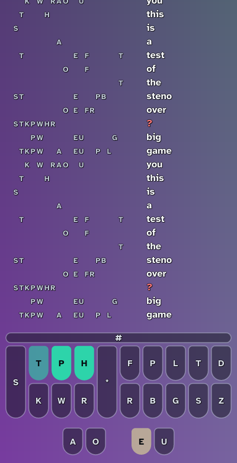

# keymux ⌨️

**QMK-inspired keyboard customization for Linux** - A blazing-fast, zero-latency keyboard middleware daemon that brings advanced QMK features to any keyboard

## ✨ Features

### Core Functionality
- **QMK-Style Mod-Tap (MT)**: Advanced tap/hold with permissive hold, roll detection, chord detection, adaptive timing
- **Adaptive Timing**: Per-key personalized thresholds that learn your typing patterns
- **Custom Layers**: Define unlimited layers (navigation, numpad, symbols, etc.)
- **Game Mode**: Automatic detection via Steam/Gamescope with SOCD support
- **SOCD Cleaner**: Last-input-priority for FPS games (eliminates W+S conflicts)
- **Command Runner**: Execute arbitrary shell commands on key press
- **Per-Keyboard Configs**: Different keymaps for different keyboards
- **Hot-Reload**: Automatic config reload on file save with desktop notifications
- **Full Keyboard Tracking**: Collects tap statistics for 100% of keyboard keys

### Advanced Features
- **Zero Input Lag**: Direct evdev access with non-blocking I/O
- **Multi-Keyboard Support**: Handle multiple keyboards simultaneously
- **Hotplug Detection**: Automatically detect keyboard connect/disconnect
- **Hardware-Based IDs**: Keyboards identified by USB properties, not device paths
- **Adaptive Statistics**: View real-time typing analytics with `adaptive-stats` command
- **Shell Completions**: Bash, Zsh, Fish support built-in

### System Integration
- **Systemd Service**: Runs as user service with automatic startup
- **Desktop Notifications**: Config reload success/error notifications
- **IPC Architecture**: Manage keyboards without restarting daemon
- **RON Configuration**: Human-readable config with extensive comments

## 🔧 Installation

### Arch Linux (AUR)

```bash
yay -S keymux
```

The package's post-install message tells you exactly which service(s) to
enable, based on the compositor/init system it detects on your machine.

### From Source (any distro)

#### Prerequisites

The root daemon needs no group membership (it runs as root, see below), but
the unprivileged `keymux list`/`toggle`/`debug` commands read `/dev/input`
directly as your user, so add yourself to the `input` group for those:
```bash
sudo usermod -a -G input $USER
# Log out and log back in for changes to take effect
```
Key remapping also needs the `uinput` kernel module loaded:
```bash
sudo modprobe uinput
echo uinput | sudo tee /etc/modules-load.d/uinput.conf   # load it on every boot
```

#### Build and install

```bash
# Clone and build
git clone https://github.com/noahlyk/keymux.git
cd keymux
cargo build --release

# Install the binary
sudo cp target/release/keymux /usr/bin/

# Install the service(s) for your init system + compositor - see
# systemd/, openrc/, or runit/ for the full list. Example for systemd + Niri:
sudo cp systemd/keymux.service /usr/lib/systemd/system/
cp systemd/keymux-niri.service ~/.config/systemd/user/

# Enable and start the root daemon
sudo systemctl enable --now keymux.service
# Enable the compositor watcher (as your normal user, not root)
systemctl --user enable --now keymux-niri.service
```

Without any service manager, you can also just run `sudo keymux daemon`
directly in a terminal (and `keymux niri-daemon` / `keymux hyprland-daemon` /
etc. for the compositor watcher), which is useful for testing before wiring
up services.

### Post-Installation Setup

1. **Create your config:**
```bash
keymux init          # minimal starter config (home-row mod-tap only)
keymux init --full   # or the full-featured reference config instead
```

2. **Edit your config:**
```bash
$EDITOR ~/.config/keymux/config.ron
```

3. **Select which keyboards to enable:**
```bash
keymux toggle
```

4. **Check everything is wired up correctly:**
```bash
keymux debug
```

### Services

**Root daemon (required):** owns the actual keyboard devices and does the
remapping. Runs as root because raw `/dev/input` access and creating a
virtual `/dev/uinput` device both require it. Internally it's a *single*
process that multiplexes per logged-in user (see `ARCHITECTURE.md`) - you
never run more than one copy of this, even on a multi-user machine.
- Path: `/usr/lib/systemd/system/keymux.service`
- Enable: `sudo systemctl enable --now keymux.service`

**Compositor watcher (optional, one per compositor):** a small per-user
process (`keymux niri-daemon`, `keymux hyprland-daemon`, `keymux sway-daemon`,
`keymux i3-daemon`, `keymux bspwm-daemon`) that watches window focus changes
and reports them to the root daemon for automatic game mode detection. Only
install the one matching your compositor/WM.
- Path: `/usr/lib/systemd/user/keymux-<compositor>.service`
- Enable: `systemctl --user enable --now keymux-niri.service` (or
  `-hyprland`/`-sway`/`-i3`/`-bspwm`)

**Steno overlay (optional):** `keymux overlay` draws the steno keyboard and tape on
screen while a steno layer is on. Needs a Wayland compositor with layer-shell (niri,
Hyprland, Sway; not GNOME). See [On-screen overlay](#on-screen-overlay).
- Path: `/usr/lib/systemd/user/keymux-overlay.service`
- Enable: `systemctl --user enable --now keymux-overlay.service`

## 📖 Configuration Guide

### Configuration File Location

`~/.config/keymux/config.ron`

### Basic Structure

```ron
(
    tapping_term_ms: 130,
    enabled_keyboards: [
        "*",                      // enable all by default
        // "6913",                 // enable keyboard with 6913 in ID
        // "Keychron K2",          // enable by keyboard name
        // "1234": Enable,         // explicit enable (map syntax)
        // "event3": Disable,      // disable by event path
        // ("1234", "Enable"),    // explicit enable (tuple syntax)
    ],
    remaps: { /* base layer keymaps */ },
    layers: { /* additional layers */ },
    game_mode: ( remaps: { /* game mode keymaps */ } ),
    per_keyboard_overrides: { /* per-keyboard configs */ },
    
    // MT configuration (all optional, shown with defaults)
    mt_config: (
        permissive_hold: true,
        enable_roll_detection: true,
        enable_chord_detection: true,
        enable_multi_mod_detection: true,
        enable_cross_hand_unwrap: true,
        enable_double_tap_hold: true,
        enable_adaptive_timing: true,
        pause_learning_in_game_mode: true,
        roll_threshold_ms: 100,
        chord_threshold_ms: 100,
        target_margin_ms: 30,
        ema_alpha: 0.02,
        auto_save_interval_secs: 30,
    ),
)
```

#### Behavior Settings

- **tapping_term_ms** (default: 130)
  - Base time threshold for tap vs hold decision
  - When adaptive timing is enabled, this serves as the initial/fallback threshold
  - 100-130ms: More sensitive to holds
  - 150-200ms: More sensitive to taps

- **enabled_keyboards** - Which keyboards to process:
  - Absent/omitted: Enable all keyboards (equivalent to `["*"]`)
  - `None`: Disable all (no keyboards enabled)
  - `["*"]`: Enable all keyboards
  - `["1234", "5678"]`: Enable keyboards matching these patterns
  - `["*", "1234": Disable]`: Enable all except 1234
  
  **Syntax options:**
  - Map style: `"pattern": Enable`, `"pattern": Disable`
  - Tuple style: `("pattern", "Enable")`, `("pattern", "Disable")`
  - Bare string: `"1234"` = enable keyboard matching 1234

- **mt_config** - Configuration for Mod-Tap (MT) keys
  - **permissive_hold** (default: true): When another key is pressed while MT is held, resolve immediately to hold
  - **enable_roll_detection** (default: true): Fast same-hand rolls favor tap (prevents accidental holds during typing)
  - **enable_chord_detection** (default: true): Opposite-hand chords favor hold (e.g., Ctrl+C with home row mods)
  - **enable_multi_mod_detection** (default: true): Multiple mods on same hand promote to hold
  - **enable_cross_hand_unwrap** (default: true): Holding opposite-hand mod unwraps MT keys to tap (prevents Shift+Shift)
  - **enable_double_tap_hold** (default: true): Double-tap then hold to hold the tap key instead of modifier
  - **enable_adaptive_timing** (default: true): Learn per-key personalized thresholds from your typing patterns
  - **pause_learning_in_game_mode** (default: true): Disable adaptive learning when game mode is active
  - **roll_threshold_ms** (default: 100): Max time between keys to count as roll
  - **chord_threshold_ms** (default: 100): Max time between keys to count as chord
  - **target_margin_ms** (default: 30): Safety margin added to average tap duration for adaptive threshold
  - **ema_alpha** (default: 0.02): Exponential moving average smoothing factor (~100 sample window)
  - **auto_save_interval_secs** (default: 30): How often to save adaptive statistics to disk

### Available Key Codes

**Letters:** `KC_A` through `KC_Z`
**Numbers:** `KC_1` through `KC_0`
**Modifiers:** `KC_LCTL`, `KC_LSFT`, `KC_LALT`, `KC_LGUI`, `KC_RCTL`, `KC_RSFT`, `KC_RALT`, `KC_RGUI`
**Special:** `KC_ESC`, `KC_CAPS`, `KC_TAB`, `KC_SPC`, `KC_ENT`, `KC_BSPC`, `KC_DEL`
**Function:** `KC_F1` through `KC_F12`
**Arrows:** `KC_LEFT`, `KC_DOWN`, `KC_UP`, `KC_RGHT`

### Available Actions

#### Key(KeyCode)
Direct key mapping.
```ron
KC_CAPS: Key(KC_ESC),  // Caps Lock becomes Escape
```

#### MT(tap_key, hold_key)
QMK-style Mod-Tap with advanced features:
- **Tap**: Quick press emits tap_key (base key)
- **Hold**: Long press emits hold_key (modifier)
- **Permissive Hold**: Pressing another key while MT is held resolves immediately to hold
- **Roll Detection**: Fast same-hand rolls favor tap (prevents accidental holds during typing)
- **Chord Detection**: Opposite-hand chords favor hold (e.g., Ctrl+C with home row mods)
- **Cross-Hand Unwrap**: Holding opposite-hand mod unwraps MT keys to tap (prevents Shift+Shift conflicts)
- **Double-Tap-Hold**: Press twice quickly then hold to hold the tap key instead of modifier
- **Adaptive Timing**: Learns per-key personalized thresholds from your typing patterns

```ron
// Home row mods - left hand
KC_A: MT(KC_A, KC_LGUI),  // Tap 'a', hold for Super/Win/Cmd
KC_S: MT(KC_S, KC_LALT),  // Tap 's', hold for Alt
KC_D: MT(KC_D, KC_LCTL),  // Tap 'd', hold for Ctrl
KC_F: MT(KC_F, KC_LSFT),  // Tap 'f', hold for Shift

// Space/Control overload
KC_SPC: MT(KC_SPC, KC_LCTL),  // Tap Space, hold Ctrl

// Examples of MT behavior:
// - Quick press A = 'a'
// - Hold A (130ms+) = Super/Cmd held
// - Hold A + press J = Super+J (permissive hold)
// - Type "as" quickly (roll) = "as" (not Alt+s)
// - A on left + J on right quickly = 'a' then 'j' (chord detection)
// - Hold D (Ctrl) + press A = Ctrl+A (cross-hand unwrap prevents Cmd+A)
// - Double-tap-hold SPC = hold Space key (not Ctrl)
```

All MT features are configurable via `mt_config` (see Behavior Settings section).

#### Layer actions
Layers are named in quotes. Layers stack: a key falls through the layers that are on until something remaps it. See [Layer switching](#layer-switching) in ARCHITECTURE.md for the full rules.

- `MO("nav")` — momentary (QMK's `MO`): the layer is on while the key is held, off when released
- `TG("nav")` — toggle: press to turn on, press again to turn off
- `TO("steno")` — exclusive (QMK's `TO`): turns every other layer off, then turns this one on and keeps it on. `TO("base")` leaves every layer and returns to base

> **Breaking change:** `TO` used to be the hold action. It now switches exclusively, the way QMK's `TO` does. Change every hold `TO("layer")` to `MO("layer")`. `SWITCH` was removed, since `TO` does the same thing.
- `Transparent` — look this key up on the layer below

```ron
KC_LALT: MO("nav"),                // Hold Alt for nav
KC_F9: TG("nohrm"),                // Toggle nohrm on and off
KC_F1: TO("steno"),                 // Steno stays on until F10
KC_F10: TO("base"),                // Leave steno
KC_F8: TO("stenopractice"),    // Only stenopractice is on afterwards
```

A keyboard can start with a layer already on, with `default_layer: Some("steno")` in `per_keyboard_overrides` (or globally at the top level).

#### Layer priority
When more than one layer is on, `priority` decides which is above the other. A layer with a higher priority is always above a lower one, whichever was turned on first. The base layer is `0`, and a layer that doesn't set `priority` is `1`.

```ron
layers: {
    "nav": ( remaps: { /* ... */ } ),                       // priority 1, the default
    "symbols": ( priority: 2, remaps: { /* ... */ } ),      // always above nav
    "steno": ( priority: 10, kind: Steno(()), remaps: {} ), // above everything else
}
```

- **Same priority:** the layer turned on last is on top. With no priorities set, this is how layers have always behaved.
- **Higher priority:** holding `symbols` and then `nav` leaves `symbols` on top, and so does holding `nav` and then `symbols`. A key goes to the top layer that remaps it, and falls through to the layers below it, as before.
- **Turning on a layer that is already on** raises it above the other layers of its priority. It is never on the stack twice.
- **Priority 0** puts a layer level with base, so it is above base but below every layer that doesn't set a priority.
- **Steno:** only the top layer's steno engine captures strokes, so a layer with a higher priority than your steno layer takes the keys while it is on.
- Hot reload sees a changed `priority` as a real change, and leaving the default written out (`priority: 1`) as no change.

#### MULTI([...])
Press several actions at once, and release them together.
```ron
KC_F1: MULTI([KC_LSFT, KC_A]),     // Holds Shift while A is pressed: types a capital A
KC_F2: MULTI([KC_B, MO("nav")]),   // Types b and holds the nav layer until F2 is released
```

#### OSM(KeyCode)
One-shot modifier: tap once, and the modifier applies to the next key only. It expires after `oneshot_timeout_ms` (default 5000).
```ron
KC_LSFT: OSM(KC_LSFT),
```

#### DT(single_tap, double_tap)
Tap dance: a single tap does the first action, and a double tap within `double_tap_window_ms` (default 250) does the second.
```ron
KC_LALT: DT(KC_LALT, MO("nav")),   // Tap for Alt, double-tap for nav
```

#### SOCD(key, [opposing_keys...])
SOCD cleaner for gaming (last-input-priority).
```ron
KC_W: SOCD(KC_W, [KC_S]),  // Pressing W then S = S, release S = W again
```

#### CMD (Command Runner)
Execute arbitrary shell commands on key press.
```ron
KC_F1: CMD("/usr/bin/notify-send 'Hello from keyboard!'"),
KC_F2: CMD("/usr/bin/playerctl play-pause"),
```

### Example Configurations

#### Minimal Config (Mod-Tap Only)

```ron
(
    tapping_term_ms: 130,
    enabled_keyboards: [
        "*",  // enable all keyboards
    ],

    remaps: {
        // Escape/Caps swap
        KC_CAPS: KC_ESC,
        KC_ESC: KC_GRV,

        // Mod-Tap - left hand
        KC_A: MT(KC_A, KC_LGUI),
        KC_S: MT(KC_S, KC_LALT),
        KC_D: MT(KC_D, KC_LCTL),
        KC_F: MT(KC_F, KC_LSFT),

        // Mod-Tap - right hand
        KC_J: MT(KC_J, KC_RSFT),
        KC_K: MT(KC_K, KC_RCTL),
        KC_L: MT(KC_L, KC_RALT),
        KC_SCLN: MT(KC_SCLN, KC_RGUI),
    },

    layers: {},
    game_mode: (remaps: {}),
    per_keyboard_overrides: {},
)
```

#### Advanced Config (Layers + Game Mode + Custom MT Timing)

```ron
(
    tapping_term_ms: 130,
    enabled_keyboards: [
        "2e3c:c365:0110:0003",  // enable specific keyboard by ID
    ],

    remaps: {
        KC_CAPS: KC_ESC,
        KC_ESC: KC_GRV,
        KC_LALT: MO("nav"),

        KC_A: MT(KC_A, KC_LGUI),
        KC_S: MT(KC_S, KC_LALT),
        KC_D: MT(KC_D, KC_LCTL),
        KC_F: MT(KC_F, KC_LSFT),
        KC_J: MT(KC_J, KC_RSFT),
        KC_K: MT(KC_K, KC_RCTL),
        KC_L: MT(KC_L, KC_RALT),
        KC_SCLN: MT(KC_SCLN, KC_RGUI),
    },

    layers: {
        "nav": (
            remaps: {
                // Keep modifiers accessible
                KC_A: Key(KC_LGUI),
                KC_S: Key(KC_LALT),
                KC_D: Key(KC_LCTL),
                KC_F: Key(KC_LSFT),

                // Vim-style navigation
                KC_H: Key(KC_LEFT),
                KC_J: Key(KC_DOWN),
                KC_K: Key(KC_UP),
                KC_L: Key(KC_RGHT),
            },
        ),
    },

    game_mode: (
        remaps: {
            KC_CAPS: KC_ESC,
            KC_ESC: KC_GRV,

            // SOCD for FPS gaming
            KC_W: SOCD(KC_W, [KC_S]),
            KC_S: SOCD(KC_S, [KC_W]),
            KC_A: SOCD(KC_A, [KC_D]),
            KC_D: SOCD(KC_D, [KC_A]),
        },
    ),

    per_keyboard_overrides: {},

    // Optional: Customize MT behavior
    mt_config: (
        permissive_hold: true,
        enable_roll_detection: true,
        enable_chord_detection: true,
        enable_adaptive_timing: true,
        target_margin_ms: 40,  // More conservative margin (default: 30)
        ema_alpha: 0.01,       // Slower learning (default: 0.02)
    ),
)
```

### Timing Configuration

- **tapping_term_ms**: Base time threshold for tap vs hold (130-200ms recommended)
  - When adaptive timing is enabled, this serves as the initial/fallback threshold
  - Lower value = more sensitive to holds, higher = more sensitive to taps
  - Recommended: 130ms for mechanical keyboards, 150-180ms for laptops

### Adaptive Timing

The MT system can learn your typing patterns and personalize thresholds per key:
- **How it works**: Records tap durations when keys resolve to TAP (below threshold)
- **Formula**: `adaptive_threshold = average_tap_duration + target_margin_ms`
- **Tracks all keys**: Collects statistics for 100% of keyboard (A-Z, numbers, F-keys, etc.)
- **Exponential moving average**: Uses α=0.02 (~100 sample window) for smooth adaptation
- **Starts immediately**: Begins learning after first tap (no minimum sample requirement)
- **Game mode aware**: Pauses learning during games to avoid skewing data

View statistics: `keymux adaptive-stats`
Clear statistics: `keymux clear-stats`

### Game Mode Detection

Game mode activates automatically when the focused window matches one of:
1. **Gamescope**: app_id is `gamescope`
2. **Steam games**: app_id starts with `steam_app_`
3. **Wine games**: app_id is `wine`/`wine-*` or ends in `.exe`, **and** the
   process's working directory or command line looks like a known
   game-library location (Steam's `steamapps/common`, GOG, Epic, itch.io,
   Lutris/Heroic's default install dirs, or a generic `Games` folder). This
   second check exists on purpose: an app_id alone only proves "this is a
   Windows binary running under Wine," not "this is a game" - a Wine-run
   installer, utility, or launcher UI (e.g. Battle.net's own window) would
   match the app_id half just as easily. Detection here is intentionally
   biased toward false negatives over false positives - if it can't
   confirm a game-library path, it leaves the window alone rather than
   guessing (use `keymux gamemode window on` to force it when that happens).
4. **Roblox**: app_id is/contains `roblox`
5. **Epic Games**: app_id contains `epicgames`
6. **Lutris / Heroic**: app_id contains `lutris`/`heroic`
7. **Sober**: app_id is `org.vinegarhq.Sober`
8. **.NET games**: app_id is `dotnet` **and** the window title matches a
   known game (Terraria, Stardew Valley, Minecraft, and others) - same
   false-negative bias as Wine above: an unrecognized title under a
   `dotnet` app_id is left as Normal rather than assumed to be a game.
9. **IS_GAME env var**: the process has `IS_GAME=1` in its environment
10. **Process tree**: a parent process is `gamescope` or `gamemode`(d)

This runs per-compositor (Niri, Hyprland, Sway, i3, bspwm - see
Installation), and is intentionally a fixed set of heuristics, not something
you edit in `config.ron`. When a heuristic gets something wrong for a
specific app, override it instead of fighting the config:

```bash
# Force game mode on/off for the app_id you're currently focused on
keymux gamemode window on
keymux gamemode window off
keymux gamemode window toggle
# Back to automatic detection for that app
keymux gamemode window auto
# See all active per-app overrides
keymux gamemode window list

# System-wide kill switch, ignoring every per-window rule/override
keymux gamemode global always-on
keymux gamemode global always-off
keymux gamemode global auto      # default: defer to window overrides / detection
keymux gamemode global status
```

All of these target the currently focused window by default, or take an
explicit app_id (`keymux gamemode window off com.obsproject.Studio`). They
are **session-only**: overrides live in the running daemon's memory and
reset to automatic detection on every daemon restart - they're meant for
quick corrections, not a permanent rule change.

## 🎹 Steno

keymux can turn a layer into a stenography (steno) machine that types Plover-format dictionaries. Chords are pressed on the stroke keys of your keyboard, and each stroke is translated as soon as its keys come up.

### Dictionaries

A new install has none. A steno layer still works: each stroke you make types its own keys,
such as `STPWHA-UBGSZ` (capitals, one hyphen between the hands, the star on the right), and `*`
takes it back like any word. Install a dictionary with one command:

```sh
keymux steno theory plover     # download Plover's dictionary
keymux steno theory lapwing    # or Lapwing's; the other one is switched off, not deleted
keymux steno theory            # show what is installed
```

Whenever keymux starts with a steno layer in the config, it makes `~/.config/keymux/steno/` if
it isn't there, with a small `00-user.json` of your own to edit (`KAT` is `cat`, `-T` is `the`;
delete it if you don't want it). Until a theory is installed, steno tells you how to. **Every `.json` file in it, at any depth, is part of your dictionary.**
To add your own, drop a file in; to switch one off, start its name with `disabled`.

```
~/.config/keymux/steno/
├── 00-user.json            your own entries: `keymux steno add KAT "cat"` writes here
├── medical.json            any file you add
├── work/                   folders can nest as deep as you like
│   └── names.json
├── lapwing/                a theory, installed by `keymux steno theory lapwing`
│   └── lapwing-base.json
├── disabled_plover/        switched off: anything starting with `disabled` is skipped
```

The parsed copies keymux keeps for fast startup live in `~/.cache/keymux/steno/`, one file per
set of dictionaries, written over in place. They are safe to delete; they are made again.

**Priority.** When two entries have the same stroke, the one from the earlier file wins. A folder
is one unit: it ranks among its neighbours by its own name, everything inside it stays together
at that spot, and the order inside only decides between the things in it. In each folder, in
this order:

1. **Names starting with a number**, files and folders alike, lowest number first (`2-` comes
   before `10-`). However big the number, it beats any plain name: a number is a priority, and
   having none is the lowest priority there is.
2. **Plain files**, which have no number.
3. **Plain folders.**

Anything tied, such as two names with the same number, goes by alphabetical order (ignoring
case), and then by the exact name (capitals first), so the order never depends on the disk.
Digits only count as a number when they stand alone: `00-user.json` and `10.json` are numbered,
`3dprinting.json` is just a name.

The installed theory is a plain folder, so everything numbered beats it, and so does any plain
file of yours. You override an entry by writing it in a file of your own, without touching
Lapwing's. If you want it to win over a plain folder as well, give your folder a number. To make
a theory beat something of yours, give *its* folder a number, such as `00-lapwing/`: folders are
found by a hidden marker file inside, not by name, so you can rename them.

```
00-user.json            numbered: first
20-mine/                a numbered folder ranks against files by its own number...
├── 00-first.json       ...and what is inside only orders the inside
└── notes.json
medical.json            plain file
work/                   plain folder, after plain files
lapwing/                a theory: plain too, so it comes down here
```

**Live.** Nothing needs restarting or reloading. keymux watches the folder, and when any file
changes (saved, added, renamed, removed), it rebuilds the dictionary on a background thread and
swaps it in between two strokes, without leaving steno mode. Watching costs no CPU while
nothing changes. If a file is saved half-finished and doesn't parse, the dictionary in use
stays until the next save fixes it.

`keymux steno theory <name>` downloads a theory into its own folder the first time, and after
that only renames folders, so switching is instant and never deletes anything. If you are on an
older layout (`main.json` and a `theory` file at the top, or a theory folder called just
`lapwing`), it keeps working, and `main.json` is moved into this layout the first time keymux
starts.

### Plover compatibility

A dictionary written for Plover types the same text here. keymux reads Plover's formats, and its translator, formatter and orthography are ports of Plover's own, which its tests hold to Plover's output.

**Dictionary formats**

| Format | |
|---|---|
| JSON (`.json`) | read, as UTF-8 or Latin-1 like Plover does. A value of `{plover:deleted}` hides the same outline in every dictionary after it. |
| RTF/CRE (`.rtf`) | read: the format professional steno software exchanges. Comments, conflict lists and usage data are skipped, as Plover skips them. |
| Python programmatic dictionaries (`.py`) | **not run.** They are code, and a keyboard daemon that runs as root won't execute files from your config folder. Lapwing's `jeff-phrasing.py` and the Emily and Abby modifier dictionaries are of this kind. |
| Other plugin formats (`.sgdct`, `.dct`, `.dix`, Lapwing's `.modal`) | **not read.** Export them to RTF/CRE or JSON from the software that made them. |

Outlines use Plover's notation, with number keys written as digits (`1-9`, `12K`, `-69`), and a leading slash for a word boundary (`/S`, used when the word before is finished).

**Translation language**: every operator on [Plover's page](https://plover.readthedocs.io/en/latest/translation_language.html):

- Attaching and spacing: `{^}` `{^ing}` `{pre^}` `{^-^}` and the `{:attach:...}` forms, orthography-aware suffixes (`{^ing}` after `make` is `making`, using Plover's rules and its word list), `{^ ^}`, `{*?}` `{*!}` and the `=retro_insert_space` `=retro_delete_space` forms, `\n` and `\t`, `{mode:set_space:x}`
- Glue: `{&a}`, `{:glue:a}`, and numbers made of digits, which glue to each other
- Case: `{-|}` `{>}` `{<}` and their retroactive `{*-|}` `{*>}` `{*<}`, `{:case:...}`, `{~|"^}` carrying a capital over a quote, and the modes `{mode:caps}` `title` `lower` `camel` `snake` `reset_case` `reset_space` `reset`
- Punctuation: `{.}` `{,}` `{?}` `{!}` `{:}` `{;}` and `{:stop:.}` `{:comma:,}`
- Currency: `{*($c)}` and `{:retro_currency:...}`
- Look-ahead: `{=regex/yes/no}`, such as `{=[AEIOUaeiou]/an/a}`, which fixes the word when the next one is known
- Key combinations: `{#Return}`, `{#Control_L(a)}`, `{#control(z shift(z))}`, with modifiers, sequences and Plover's key names on a US keyboard
- Actions: `=undo`, `{*+}` and `=repeat_last_stroke`, `{*}` and `=retro_toggle_asterisk`, `{}` and `{#}` (nothing), `{$}` and `{:word_end}`
- Translator behaviour: the longest match over recent strokes, `*` undoing a translation and bringing back what it replaced, and the suffix keys `-Z -D -S -G` folded into a stroke that has no entry of its own
- Commands: `{plover:suspend}` and `{plover:toggle}` leave the steno layer, `{plover:lookup}` opens keymux's lookup, `{plover:set_config:'start_attached':True}` sets how a session starts; the commands that open Plover's windows (`add_translation`, `suggestions`, `configure`, `focus`, `quit`) have nothing to open here and do nothing
- Lapwing's plugins, which its dictionaries use: `{:stitch:A}`, `{:stitch_last_word:...}`, `=repeat_last_translation`, `=repeat_last_word`, `=repeat_last_fragment`, `=repeat_last_character`

A stroke with no translation types its keys (`STPHA-UBGS`), not Plover's `STPHAUBGS`, and a first word attaches to what is already written unless `start_attached: false`. A key combination can only press keys of a US keyboard: Plover's names for accented letters (`eacute`) aren't sent.

**How it is checked.** `tools/plover-golden` runs Plover's own code and records what it does: 4,400 stroke sequences through every operator, in every start mode and with spaces before and after (`spaces_after: true` is Plover's "After Output", which Lapwing is written for); 7,900 suffixes added to words; 21,500 stroke spellings read and written; RTF files Plover writes and hand-made ones with the format's corners; and 1,800 random sequences over Plover's shipped `main.json` and `commands.json`. keymux must give the same text after every stroke, the same key combinations and the same commands.

### Config

Add a steno layer. Its name doesn't matter; `kind` is what makes it a steno layer:

```ron
"steno": (
    kind: Steno((
        layout: "qwerty",
        layout_overrides: { "S-": Key(KC_Q) },   // optional: change individual stroke keys
        dictionaries: ["~/work/steno"],          // optional: files or folders, highest priority first
        stroke_timeout_ms: 5000,                 // completes a stroke whose key never comes up
    )),
    remaps: { KC_F10: TO("base") },              // non-stroke keys: remaps still work
    disabled_in_game_mode: true,
),
```

- If `dictionaries` is empty, the layer uses the whole `steno` folder (see above). A list replaces that: each entry is a file, or a folder read the same way, and they are watched and reloaded live too.
- `spaces_after: true` puts the space after each word instead of before it (Plover's "After Output", which Lapwing is written for), `start_attached: false` makes the first word of a session start with a space, and `start_capitalized: true` capitalizes it. These are Plover's session options of the same names.
- **Holding to repeat.** Tap a stroke, then press it again soon and keep it down: it repeats until you let go. This works for every stroke, so holding `*` after a tap erases, and a held movement chord keeps moving. `double_tap_window_ms: 300` is how soon the second press must come, `repeat_delay_ms: 300` how long it is held before repeating starts, `repeat_rate_ms: 40` the time between repeats, and `disable_repeat: true` turns it off. Strokes that run an engine command (`{plover:...}`) never repeat, and a normal quick double tap is two ordinary strokes.
- **Sending on the first key up.** A stroke normally goes when its last key comes up. A dictionary entry can say it should go when the *first* key comes up instead, by carrying `{:firstup}`, as in `"#TPH-R": "{:firstup}{#Left}{^}"`. The keys still down then wait: tap `R` again and it is `#TPH-R` again, tap `P` and it is `#TPH-P`, and letting go of the held keys alone sends nothing. Only entries with the marker work this way, so a dictionary without it, such as the basic Lapwing one, is unchanged, and `disable_first_up: true` ignores the marker. The marker types nothing and changes no spacing; put it in front of `{^}` rather than after it so Plover reads it the same way. (`{^}` itself means "attach", so it can't be the marker.)
- **Erasing text so undo can bring it back.** `{#BackSpace}` presses the key, and keymux can't see what that removed, so `*` afterwards is wrong (Plover has the same flaw). `{:back}` erases the last character as part of the earlier text instead, and `{:back:3}` erases three. Undoing that stroke types the characters again and sends nothing else. With nothing typed to erase it presses Backspace. Nothing is tied to a stroke: map any entry to it, such as `"SPW": "{:back}"`.
- **One history for everything typed.** keymux keeps a single record of what is on screen, shared by every keyboard and every steno layer, and tags each entry with the *machine* that made it (the set of dictionaries). `*` takes back the last thing whoever typed it: strokes from another keyboard, even with different dictionaries, since undoing uses what was recorded, not a dictionary. Strokes only join into a longer outline with strokes from their own machine. Words typed by hand on a plain layer are in the record too (as whole words, using the `typing_layout` keyboard layout: `us`, `dvorak` or `colemak`), so going into steno carries on from them: the next word is spaced from what is there, comes out capitalised after a full stop, and `*` takes a hand-typed word back whole. A Backspace pressed by hand over a stroke is remembered too, so `*` types the character again. The record is forgotten whenever the cursor may have moved: an arrow, Home/End, Page Up/Down, Delete, Escape, a function key, a shortcut with Ctrl, Alt or Super held, or a switch to another window. `*` after that falls back to deleting a word. `fresh_on_enter: true` also forgets it each time the layer is entered, and `disable_typing_history: true` stops following plain typing.
- **Undo, redo and friends.** These work on that history and are ordinary dictionary entries, so you choose the strokes. `{:redo}` puts back what `*` took back, as many times as you undid, and any new input empties it. `{:undo:3}` (or `=undo:3`) takes back three. `{:undo_word}` takes back a whole word: a stem and the suffixes glued to it, or a word typed by hand. `{:again}` says the last thing once more, and `{:swap}` swaps the last two words. `{:redo:2}` redoes two. The tape notes each word you typed by hand, with the stroke you could have used when your dictionary has a short one.
- `keymux steno layout` shows every stroke key and the key that presses it. `layout_overrides` keys are those slot names (`S-`, `A-`, `-E`, `-U`, ...).
- On a steno layer, keys that are neither stroke keys nor remapped are swallowed, so an accidental press types nothing. Delete always passes through.
- Turn the layer on with `TO("steno")` (stays on, exclusive) or `TG("steno")` (toggle), and leave with `TO("base")`. A keyboard can also start in steno with `default_layer`.

### Typing

- Press a stroke's keys together. The stroke is translated when they come up.
- `*` undoes the last translation, including corrections that rewrote earlier text.
- Space and Backspace do nothing on a steno layer, so an accidental press can't wipe text. `*` is the way to take it back.
- With nothing on the tape, `*` presses Ctrl+Backspace, which deletes the word before the cursor in nearly every app.
- `#` repeats the last stroke.
- A stroke that matches nothing on its own, but starts a longer entry, is typed as its keys, such as `KPA-`. The next stroke completes the entry and replaces them. If it doesn't, they stay until `*` takes them back.
- A stroke that matches nothing is typed as its keys too, in capitals with one hyphen between the hands and the star on the right (`STPWHA-UBGSZ`), and is marked `?` on the tape. `*` takes it back like any word.

### Live lookup

Midway through a sentence and can't remember the stroke for a word? Write the stroke that
opens a lookup. It is an ordinary dictionary entry, as in Plover: `{PLOVER:LOOKUP}`. Lapwing
already has it as `PHRUP` and `PHR*UP`, and you can add your own to any dictionary, for example
`"HRAOUP": "{PLOVER:LOOKUP}"` in `00-user.json`.

- You stay on the steno layer, but its keys go through your **full base layer** for a moment:
  remaps, mod-taps, held layers (a symbol layer, say) and Shift all work as everywhere else.
  What comes out types the word you're after into a query, shown as `LOOKUP` on the
  [overlay](#on-screen-overlay). Nothing you type reaches the application, so your document
  is untouched. (Letters follow `typing_layout`, `us` by default.)
- The overlay lists the strokes that type the word, fewest strokes first, with words that
  start with what you've typed after them. The first stroke of the best one is lit on the
  overlay's keyboard.
- Backspace edits the query, Shift capitalizes (lookups are case-sensitive), and **Esc or
  Enter** closes it, including a key you remapped to either. You're straight back in steno,
  mid-sentence.
- A key that leaves the steno layer (such as one that goes back to base) leaves the lookup
  behind. Tab and the arrow keys do nothing in it.

Like any command, the stroke fires on its own, so it can't be the start of a longer outline.
`keymux steno stroke HRAOUP` shows what a stroke types now, and "has no translation" means
it's free. It needs the overlay running to show anything (`keymux overlay`), since that is
where the query and results appear. `keymux steno keys "word"` does the same lookup from a
terminal.

### Steno commands

| Command | What it does |
|---|---|
| `keymux steno theory lapwing` | Install Lapwing (or `plover`) and switch the other off. With no name, show what is installed |
| `keymux steno layout` | Show every stroke key, the key that presses it, and its sound |
| `keymux steno keys "candy"` | Show every outline that types a word properly. Words are split on spaces |
| `keymux steno keys "candy" --fast` | Show only the fewest-stroke outline for each word |
| `keymux steno keys "candy" --show-keys` | Also show the physical keys that press each stroke |
| `keymux steno keys` | With no text, an interactive session: type strings one after another |
| `keymux steno lookup cat` | Show the strokes that type a word (case-sensitive, as the dictionary spells it) |
| `keymux steno stroke "KPA/TKAOEU"` | Show what a stroke types. Use `/` between strokes of one word |
| `keymux steno add KAT "cat"` | Add or replace an entry in `00-user.json`, which beats every other dictionary |
| `keymux steno tape` | Show what each recent stroke typed. `-f` keeps printing new strokes, `-n N` sets how many lines to start with |

### On-screen overlay

`keymux overlay` shows the steno keyboard and a tape down the right edge of the screen while a
steno layer is on, and goes away when you leave it. The tape runs the full screen height with
the keyboard at the bottom. Keys are steno pads (round at the bottom, nearly square at the top)
that light up as you press them, coloured by part of the keyboard: green for the left hand,
yellow for the vowels, red for the right hand, light blue for `*` and `#`. Keys you've let go
of but that are still part of the stroke are dimmer. Each finished stroke lands on the tape
with what it typed: the steno letters tightly set in their own columns, and the word in larger
white text. Every tape line is at full strength; only the top three fade out. There is no
background by default, only the keys and text (the text has a soft shadow to read over any
wallpaper; set `background` for a panel if your wallpaper is very busy), and it never takes
clicks or focus. It costs next to nothing: it only redraws when a key or the tape changes.



It runs as your user, since the daemon runs as root and can't draw on your screen. Start it
with `systemctl --user enable --now keymux-overlay.service`, or run `keymux overlay` by hand.
It needs a Wayland compositor with `wlr-layer-shell`: niri, Hyprland and Sway have it, GNOME
doesn't.

```ron
overlay: (
    enabled: true,
    output: None,        // Some("DP-1") to pin a monitor; None lets the compositor pick
    margin: 0,           // gap from the right edge, in pixels
    width: 340,          // as tall as the screen; text and keys are sized from this
    text_scale: 1.0,     // 1.2 makes the text a fifth bigger, on top of what width gives
    background: 0.0,     // opacity of a dark panel behind it all; 0.0 is fully transparent
    keyboard: true,
    tape: true,
    tape_lines: None,    // Some(20) caps the tape; None fills the screen height
    font: None,          // path to a .ttf/.otf; None uses the bundled Atkinson Hyperlegible
    layers: [],          // steno layers that show it; empty means all of them
),
```

Every field is optional, and edits to the config file apply without restarting the overlay.
In niri, style it with `layer-rule { match namespace="^keymux-steno$" }`.
`keymux overlay --always` keeps it on screen on every layer, not only steno ones (the
`layers` list is ignored too; `enabled: false` still turns it off). `keymux overlay --demo`
draws made-up strokes to try the look without the daemon, and `keymux overlay --dump`
prints what the daemon sends. With several keyboards, it follows the
one you last pressed a key on.

## 🎮 Usage

### Daemon Management

```bash
# Start daemon (automatically started by systemd)
keymux daemon

# Check status
systemctl status keymux

# View live logs
journalctl -u keymux -f

# Restart daemon
systemctl restart keymux
```

### Keyboard Management

```bash
# List all detected keyboards
keymux list

# Toggle which keyboards are enabled (interactive menu)
keymux toggle

# Enable specific keyboards by ID or name
keymux enable 6912           # by partial ID
keymux enable "Keychron"     # by name
keymux enable "*"            # enable all

# Disable specific keyboards by ID or name  
keymux disable 6912          # by partial ID
keymux disable "Built-in"    # by name
keymux disable "*"           # disable all

# Open multi-select menu to choose keyboards
keymux toggle --multi
keymux enable --multi
keymux disable --multi

# Validate your config
keymux validate

# Reload config (automatic on file save, but manual trigger available)
keymux reload

# Game mode is detected automatically (see Game Mode Detection above),
# or controlled manually:
keymux gamemode window off
keymux gamemode global always-on

# View adaptive timing statistics
keymux adaptive-stats

# Clear adaptive timing statistics (prompts for confirmation)
keymux clear-stats

# Debug mode (show all keyboard events in real-time)
keymux debug
```

### Shell Completions

```bash
# Bash
keymux completion bash | sudo tee /usr/share/bash-completion/completions/keymux

# Zsh
keymux completion zsh | sudo tee /usr/share/zsh/site-functions/_keymux

# Fish
keymux completion fish > ~/.config/fish/completions/keymux.fish
```

## 🚪 Releasing a keyboard from keymux

Press **Alt+F12** as the very first key after a keyboard attaches to release it. keymux stops handling that keyboard, and you get a notification. Replug the keyboard to use keymux with it again.

Only the first key press counts. If any other key is pressed first, the chord no longer works until the keyboard is replugged. This keeps a stray Alt+F12 in the middle of typing from releasing the keyboard.

Use this if a bad config or a stuck layer leaves the keyboard unusable: release it, fix the config, and replug.

## 🐛 Troubleshooting

### "Permission denied" errors

Add yourself to the `input` group:
```bash
sudo usermod -a -G input $USER
```
Then log out and back in.

### "Device or resource busy"

Another process is grabbing your keyboard. Check for:
```bash
# Kill any existing instances
pkill -f keymux

# Check for other remapping tools
ps aux | grep -E "kmonad|keyd|xremap"
```

### Config errors

Watch the logs when editing config:
```bash
journalctl -u keymux -f
```

Config errors show desktop notifications and keep the previous working config.

### Hot-reload not working

Ensure the daemon is running:
```bash
systemctl status keymux
```

Check file watcher is working (should see "Config reloaded" in logs when you save).

### "MT keys trigger hold too fast/slow"

**Option 1: Adjust base threshold**
- **100-130ms**: More sensitive to holds
- **150-200ms**: More sensitive to taps
- **Recommended**: 130ms for mechanical keyboards, 150-180ms for laptops

**Option 2: Enable adaptive timing** (recommended)
- Set `mt_config.enable_adaptive_timing: true` (enabled by default)
- The system learns your typing patterns and personalizes thresholds per key
- View statistics: `keymux adaptive-stats`
- Increase safety margin: `mt_config.target_margin_ms: 40` (default: 30)

**Option 3: Adjust detection features**
- Disable roll detection: `mt_config.enable_roll_detection: false`
- Disable chord detection: `mt_config.enable_chord_detection: false`
- Disable permissive hold: `mt_config.permissive_hold: false`

### "W+S both pressed in game, not moving"

Use SOCD in game_mode (see configuration examples above).

## 📚 Related Projects

Alternative keyboard remapping tools with different approaches:

- **[kmonad](https://github.com/kmonad/kmonad)** - Haskell-based, cross-platform, mature codebase, S-expression config
- **[keyd](https://github.com/rvaiya/keyd)** - C-based, key remapping via config files, active development
- **[kanata](https://github.com/jtroo/kanata)** - Rust-based, cross-platform, programmable key remapper
- **[xremap](https://github.com/xremap/xremap)** - Python-based, X11 only, older project

Each has different strengths - choose based on your platform, performance needs, and configuration preferences.

## 📚 Further Reading

- [QMK Documentation](https://docs.qmk.fm/) - Inspiration for this project
- [Home Row Mods Guide](https://precondition.github.io/home-row-mods) - Deep dive into HRM techniques
- [Colemak Mod-DH](https://colemakmods.github.io/mod-dh/) - Alternative keyboard layout with better HRM placement

## 🤝 Contributing

Contributions are welcome! Feel free to open issues or submit pull requests.

## 📄 License

MIT License - See [LICENSE](LICENSE) for details.

## 🙏 Acknowledgments

- Inspired by [QMK Firmware](https://qmk.fm/)
- Built with Rust and [evdev](https://github.com/emberian/evdev)
