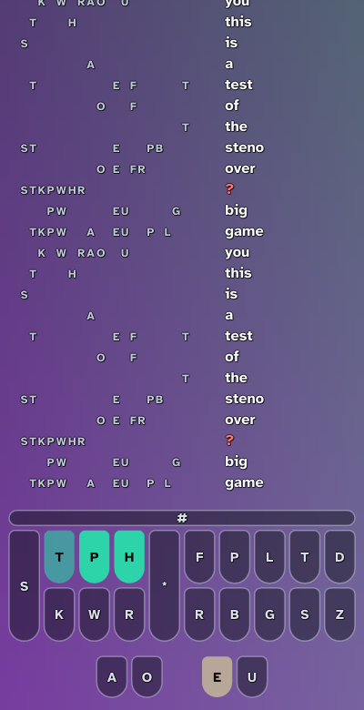

# keymux ⌨️

**QMK-inspired keyboard customization for Linux** - A blazing-fast, zero-latency keyboard middleware daemon that brings advanced QMK features to any keyboard

## ✨ Features

### Core Functionality
- **QMK-Style Mod-Tap (MT)**: Advanced tap/hold with permissive hold, roll detection, chord detection, adaptive timing
- **Adaptive Timing**: Per-key personalized thresholds that learn your typing patterns
- **Custom Layers**: Define unlimited layers (navigation, numpad, symbols, etc.)
- **Game Mode**: Automatic detection via Steam/Gamescope with SOCD support
- **SOCD Cleaner**: Last-input-priority for FPS games (eliminates W+S conflicts)
- **Command Runner**: Execute arbitrary shell commands on key press
- **Per-Keyboard Configs**: Different keymaps for different keyboards
- **Hot-Reload**: Automatic config reload on file save with desktop notifications
- **Full Keyboard Tracking**: Collects tap statistics for 100% of keyboard keys

### Advanced Features
- **Zero Input Lag**: Direct evdev access with non-blocking I/O
- **Multi-Keyboard Support**: Handle multiple keyboards simultaneously
- **Hotplug Detection**: Automatically detect keyboard connect/disconnect
- **Hardware-Based IDs**: Keyboards identified by USB properties, not device paths
- **Adaptive Statistics**: View real-time typing analytics with `adaptive-stats` command
- **Shell Completions**: Bash, Zsh, Fish support built-in
- **Plugins**: Drop an ordinary `.rs` file into `~/.config/keymux/plugins/` to extend what a stroke that misses every dictionary does, compiled to sandboxed WebAssembly, no build step by hand — see [`docs/plugins/README.md`](docs/plugins/README.md)

### System Integration
- **Systemd Service**: Runs as user service with automatic startup
- **Desktop Notifications**: Config reload success/error notifications
- **IPC Architecture**: Manage keyboards without restarting daemon
- **RON Configuration**: Human-readable config with extensive comments

## 🔧 Installation

### Arch Linux (AUR)

```bash
yay -S keymux
```

The package's post-install message tells you exactly which service(s) to
enable, based on the compositor/init system it detects on your machine.

### From Source (any distro)

#### Prerequisites

The root daemon needs no group membership (it runs as root, see below), but
the unprivileged `keymux list`/`toggle`/`debug` commands read `/dev/input`
directly as your user, so add yourself to the `input` group for those:
```bash
sudo usermod -a -G input $USER
# Log out and log back in for changes to take effect
```
Key remapping also needs the `uinput` kernel module loaded:
```bash
sudo modprobe uinput
echo uinput | sudo tee /etc/modules-load.d/uinput.conf   # load it on every boot
```

#### Build and install

```bash
# Clone and build
git clone https://github.com/noahlyk/keymux.git
cd keymux
cargo build --release

# Install the binary
sudo cp target/release/keymux /usr/bin/

# Install the service(s) for your init system + compositor - see
# systemd/, openrc/, or runit/ for the full list. Example for systemd + Niri:
sudo cp systemd/keymux.service /usr/lib/systemd/system/
cp systemd/keymux-niri.service ~/.config/systemd/user/

# Enable and start the root daemon
sudo systemctl enable --now keymux.service
# Enable the compositor watcher (as your normal user, not root)
systemctl --user enable --now keymux-niri.service
```

Without any service manager, you can also just run `sudo keymux daemon`
directly in a terminal (and `keymux niri-daemon` / `keymux hyprland-daemon` /
etc. for the compositor watcher), which is useful for testing before wiring
up services.

### Post-Installation Setup

1. **Create your config:**
```bash
keymux init          # minimal starter config (home-row mod-tap only)
keymux init --full   # or the full-featured reference config instead
```

2. **Edit your config:**
```bash
$EDITOR ~/.config/keymux/config.ron
```

3. **Select which keyboards to enable:**
```bash
keymux toggle
```

4. **Check everything is wired up correctly:**
```bash
keymux debug
```

### Services

**Root daemon (required):** owns the actual keyboard devices and does the
remapping. Runs as root because raw `/dev/input` access and creating a
virtual `/dev/uinput` device both require it. Internally it's a *single*
process that multiplexes per logged-in user (see `ARCHITECTURE.md`) - you
never run more than one copy of this, even on a multi-user machine.
- Path: `/usr/lib/systemd/system/keymux.service`
- Enable: `sudo systemctl enable --now keymux.service`

**Compositor watcher (optional, one per compositor):** a small per-user
process (`keymux niri-daemon`, `keymux hyprland-daemon`, `keymux sway-daemon`,
`keymux i3-daemon`, `keymux bspwm-daemon`) that watches window focus changes
and reports them to the root daemon for automatic game mode detection. Only
install the one matching your compositor/WM.
- Path: `/usr/lib/systemd/user/keymux-<compositor>.service`
- Enable: `systemctl --user enable --now keymux-niri.service` (or
  `-hyprland`/`-sway`/`-i3`/`-bspwm`)

**Steno overlay (optional):** `keymux overlay` draws the steno keyboard and tape on
screen while a steno layer is on. Needs a Wayland compositor with layer-shell (niri,
Hyprland, Sway; not GNOME). See [On-screen overlay](#on-screen-overlay).
- Path: `/usr/lib/systemd/user/keymux-steno.service`
- Enable: `systemctl --user enable --now keymux-steno.service`

#### How the helpers follow the daemon

The compositor watchers and the steno overlay are clients of the root daemon, and they
follow it: restart the daemon and they restart, stop it and they stop doing anything, start
it and they come up.

| You do | systemd | OpenRC | runit |
|---|---|---|---|
| Restart the daemon | each helper notices within about 3 s, exits, and is started again once the daemon answers | the same, through `supervise-daemon`; `need keymux` also restarts them | the same, through `runsv` |
| Stop the daemon | each helper exits, restarts, and waits in `ExecStartPre` (state `activating`, no keymux process) | `need keymux` stops them, so they are down | they sit in `keymux wait-daemon` (running, idle) |
| Start the daemon | the waiting helpers start | `need keymux` starts them | the waiting helpers start |

How it works: every helper exits non-zero when the daemon stops answering (a Ping once a
second; three misses in a row), and the init system starts it again behind a wait step,
`keymux wait-daemon`, that blocks until the daemon answers. systemd runs it as
`ExecStartPre` with `TimeoutStartSec=infinity`; the OpenRC and runit scripts run
`keymux wait-daemon -- <helper>`, which waits and then becomes the helper. A helper started
by hand before the daemon keeps waiting for it instead of exiting.

**Caveat (systemd):** the daemon is a *system* unit and the helpers are *user* units, which
belong to a different manager, so `BindsTo=`, `PartOf=` and `Requires=` cannot link them.
That is why the helpers follow the socket instead. The cost is that after `systemctl stop
keymux` a helper shows as `activating (start-pre)`, not `inactive`. `StartLimitIntervalSec=0`
is set on them because the wait step, not a crash loop, paces their restarts; if the daemon
flaps, a start limit would otherwise leave them `failed` for good. The steno overlay is the
exception to "every failure restarts": it exits with status 78 when the session cannot show
it (no layer-shell, as on GNOME, or no Wayland), and `RestartPreventExitStatus=78` keeps
that from being retried. OpenRC and runit have no steno service script.

## 📖 Configuration Guide

### Configuration File Location

`~/.config/keymux/config.ron`

### Basic Structure

```ron
(
    tapping_term_ms: 130,
    enabled_keyboards: [
        "*",                      // enable all by default
        // "6913",                 // enable keyboard with 6913 in ID
        // "Keychron K2",          // enable by keyboard name
        // "1234": Enable,         // explicit enable (map syntax)
        // "event3": Disable,      // disable by event path
        // ("1234", "Enable"),    // explicit enable (tuple syntax)
    ],
    remaps: { /* base layer keymaps */ },
    layers: { /* additional layers */ },
    game_mode: ( remaps: { /* game mode keymaps */ } ),
    per_keyboard_overrides: { /* per-keyboard configs */ },
    
    // MT configuration (all optional, shown with defaults)
    mt_config: (
        permissive_hold: true,
        enable_roll_detection: true,
        enable_chord_detection: true,
        enable_multi_mod_detection: true,
        enable_cross_hand_unwrap: true,
        enable_double_tap_hold: true,
        enable_adaptive_timing: true,
        pause_learning_in_game_mode: true,
        roll_threshold_ms: 100,
        chord_threshold_ms: 100,
        target_margin_ms: 30,
        ema_alpha: 0.02,
        auto_save_interval_secs: 30,
    ),
)
```

#### Behavior Settings

- **tapping_term_ms** (default: 130)
  - Base time threshold for tap vs hold decision
  - When adaptive timing is enabled, this serves as the initial/fallback threshold
  - 100-130ms: More sensitive to holds
  - 150-200ms: More sensitive to taps

- **enabled_keyboards** - Which keyboards to process:
  - Absent/omitted: Enable all keyboards (equivalent to `["*"]`)
  - `None`: Disable all (no keyboards enabled)
  - `["*"]`: Enable all keyboards
  - `["1234", "5678"]`: Enable keyboards matching these patterns
  - `["*", "1234": Disable]`: Enable all except 1234
  
  **Syntax options:**
  - Map style: `"pattern": Enable`, `"pattern": Disable`
  - Tuple style: `("pattern", "Enable")`, `("pattern", "Disable")`
  - Bare string: `"1234"` = enable keyboard matching 1234

- **mt_config** - Configuration for Mod-Tap (MT) keys
  - **permissive_hold** (default: true): When another key is pressed while MT is held, resolve immediately to hold
  - **enable_roll_detection** (default: true): Fast same-hand rolls favor tap (prevents accidental holds during typing)
  - **enable_chord_detection** (default: true): Opposite-hand chords favor hold (e.g., Ctrl+C with home row mods)
  - **enable_multi_mod_detection** (default: true): Multiple mods on same hand promote to hold
  - **enable_cross_hand_unwrap** (default: true): Holding opposite-hand mod unwraps MT keys to tap (prevents Shift+Shift)
  - **enable_double_tap_hold** (default: true): Double-tap then hold to hold the tap key instead of modifier
  - **enable_adaptive_timing** (default: true): Learn per-key personalized thresholds from your typing patterns
  - **pause_learning_in_game_mode** (default: true): Disable adaptive learning when game mode is active
  - **roll_threshold_ms** (default: 100): Max time between keys to count as roll
  - **chord_threshold_ms** (default: 100): Max time between keys to count as chord
  - **target_margin_ms** (default: 30): Safety margin added to average tap duration for adaptive threshold
  - **ema_alpha** (default: 0.02): Exponential moving average smoothing factor (~100 sample window)
  - **auto_save_interval_secs** (default: 30): How often to save adaptive statistics to disk

### Available Key Codes

**Letters:** `KC_A` through `KC_Z`
**Numbers:** `KC_1` through `KC_0`
**Modifiers:** `KC_LCTL`, `KC_LSFT`, `KC_LALT`, `KC_LGUI`, `KC_RCTL`, `KC_RSFT`, `KC_RALT`, `KC_RGUI`
**Special:** `KC_ESC`, `KC_CAPS`, `KC_TAB`, `KC_SPC`, `KC_ENT`, `KC_BSPC`, `KC_DEL`
**Function:** `KC_F1` through `KC_F12`
**Arrows:** `KC_LEFT`, `KC_DOWN`, `KC_UP`, `KC_RGHT`

### Available Actions

#### Key(KeyCode)
Direct key mapping.
```ron
KC_CAPS: Key(KC_ESC),  // Caps Lock becomes Escape
```

#### MT(tap_key, hold_key)
QMK-style Mod-Tap with advanced features:
- **Tap**: Quick press emits tap_key (base key)
- **Hold**: Long press emits hold_key (modifier)
- **Permissive Hold**: Pressing another key while MT is held resolves immediately to hold
- **Roll Detection**: Fast same-hand rolls favor tap (prevents accidental holds during typing)
- **Chord Detection**: Opposite-hand chords favor hold (e.g., Ctrl+C with home row mods)
- **Cross-Hand Unwrap**: Holding opposite-hand mod unwraps MT keys to tap (prevents Shift+Shift conflicts)
- **Double-Tap-Hold**: Press twice quickly then hold to hold the tap key instead of modifier
- **Adaptive Timing**: Learns per-key personalized thresholds from your typing patterns

```ron
// Home row mods - left hand
KC_A: MT(KC_A, KC_LGUI),  // Tap 'a', hold for Super/Win/Cmd
KC_S: MT(KC_S, KC_LALT),  // Tap 's', hold for Alt
KC_D: MT(KC_D, KC_LCTL),  // Tap 'd', hold for Ctrl
KC_F: MT(KC_F, KC_LSFT),  // Tap 'f', hold for Shift

// Space/Control overload
KC_SPC: MT(KC_SPC, KC_LCTL),  // Tap Space, hold Ctrl

// Examples of MT behavior:
// - Quick press A = 'a'
// - Hold A (130ms+) = Super/Cmd held
// - Hold A + press J = Super+J (permissive hold)
// - Type "as" quickly (roll) = "as" (not Alt+s)
// - A on left + J on right quickly = 'a' then 'j' (chord detection)
// - Hold D (Ctrl) + press A = Ctrl+A (cross-hand unwrap prevents Cmd+A)
// - Double-tap-hold SPC = hold Space key (not Ctrl)
```

All MT features are configurable via `mt_config` (see Behavior Settings section).

#### Layer actions
Layers are named in quotes. Layers stack: a key falls through the layers that are on until something remaps it. See [Layer switching](#layer-switching) in ARCHITECTURE.md for the full rules.

- `MO("nav")` — momentary (QMK's `MO`): the layer is on while the key is held, off when released
- `TG("nav")` — toggle: press to turn on, press again to turn off
- `TO("steno")` — exclusive (QMK's `TO`): turns every other layer off, then turns this one on and keeps it on. `TO("base")` leaves every layer and returns to base

> **Breaking change:** `TO` used to be the hold action. It now switches exclusively, the way QMK's `TO` does. Change every hold `TO("layer")` to `MO("layer")`. `SWITCH` was removed, since `TO` does the same thing.
- `Transparent` — look this key up on the layer below

```ron
KC_LALT: MO("nav"),                // Hold Alt for nav
KC_F9: TG("nohrm"),                // Toggle nohrm on and off
KC_F1: TO("steno"),                 // Steno stays on until F10
KC_F10: TO("base"),                // Leave steno
KC_F8: TO("stenopractice"),    // Only stenopractice is on afterwards
```

A keyboard can start with a layer already on, with `default_layer: Some("steno")` in `per_keyboard_overrides` (or globally at the top level).

#### Layer priority
When more than one layer is on, `priority` decides which is above the other. A layer with a higher priority is always above a lower one, whichever was turned on first. The base layer is `0`, and a layer that doesn't set `priority` is `1`.

```ron
layers: {
    "nav": ( remaps: { /* ... */ } ),                       // priority 1, the default
    "symbols": ( priority: 2, remaps: { /* ... */ } ),      // always above nav
    "steno": ( priority: 10, kind: Steno(()), remaps: {} ), // above everything else
}
```

- **Same priority:** the layer turned on last is on top. With no priorities set, this is how layers have always behaved.
- **Higher priority:** holding `symbols` and then `nav` leaves `symbols` on top, and so does holding `nav` and then `symbols`. A key goes to the top layer that remaps it, and falls through to the layers below it, as before.
- **Turning on a layer that is already on** raises it above the other layers of its priority. It is never on the stack twice.
- **Priority 0** puts a layer level with base, so it is above base but below every layer that doesn't set a priority.
- **Steno:** only the top layer's steno engine captures strokes, so a layer with a higher priority than your steno layer takes the keys while it is on.
- Hot reload sees a changed `priority` as a real change, and leaving the default written out (`priority: 1`) as no change.

#### MULTI([...])
Press several actions at once, and release them together.
```ron
KC_F1: MULTI([KC_LSFT, KC_A]),     // Holds Shift while A is pressed: types a capital A
KC_F2: MULTI([KC_B, MO("nav")]),   // Types b and holds the nav layer until F2 is released
```

#### OSM(KeyCode)
One-shot modifier: tap once, and the modifier applies to the next key only. It expires after `oneshot_timeout_ms` (default 5000).
```ron
KC_LSFT: OSM(KC_LSFT),
```

#### DT(single_tap, double_tap)
Tap dance: a single tap does the first action, a second tap within `double_tap_window_ms` (default 250) of the first's release holds the second action until the key comes up, and holding the key past `tapping_term_ms` holds the first. A single tap goes out once the window passes, or at once when another key is pressed.
```ron
KC_LALT: DT(KC_LALT, MO("nav")),   // Tap for Alt, double-tap for nav
```

#### SOCD(key, [opposing_keys...])
SOCD cleaner for gaming (last-input-priority).
```ron
KC_W: SOCD(KC_W, [KC_S]),  // Pressing W then S = S, release S = W again
```

#### CMD (Command Runner)
Execute arbitrary shell commands on key press.
```ron
KC_F1: CMD("/usr/bin/notify-send 'Hello from keyboard!'"),
KC_F2: CMD("/usr/bin/playerctl play-pause"),
```

### Example Configurations

#### Minimal Config (Mod-Tap Only)

```ron
(
    tapping_term_ms: 130,
    enabled_keyboards: [
        "*",  // enable all keyboards
    ],

    remaps: {
        // Escape/Caps swap
        KC_CAPS: KC_ESC,
        KC_ESC: KC_GRV,

        // Mod-Tap - left hand
        KC_A: MT(KC_A, KC_LGUI),
        KC_S: MT(KC_S, KC_LALT),
        KC_D: MT(KC_D, KC_LCTL),
        KC_F: MT(KC_F, KC_LSFT),

        // Mod-Tap - right hand
        KC_J: MT(KC_J, KC_RSFT),
        KC_K: MT(KC_K, KC_RCTL),
        KC_L: MT(KC_L, KC_RALT),
        KC_SCLN: MT(KC_SCLN, KC_RGUI),
    },

    layers: {},
    game_mode: (remaps: {}),
    per_keyboard_overrides: {},
)
```

#### Advanced Config (Layers + Game Mode + Custom MT Timing)

```ron
(
    tapping_term_ms: 130,
    enabled_keyboards: [
        "2e3c:c365:0110:0003",  // enable specific keyboard by ID
    ],

    remaps: {
        KC_CAPS: KC_ESC,
        KC_ESC: KC_GRV,
        KC_LALT: MO("nav"),

        KC_A: MT(KC_A, KC_LGUI),
        KC_S: MT(KC_S, KC_LALT),
        KC_D: MT(KC_D, KC_LCTL),
        KC_F: MT(KC_F, KC_LSFT),
        KC_J: MT(KC_J, KC_RSFT),
        KC_K: MT(KC_K, KC_RCTL),
        KC_L: MT(KC_L, KC_RALT),
        KC_SCLN: MT(KC_SCLN, KC_RGUI),
    },

    layers: {
        "nav": (
            remaps: {
                // Keep modifiers accessible
                KC_A: Key(KC_LGUI),
                KC_S: Key(KC_LALT),
                KC_D: Key(KC_LCTL),
                KC_F: Key(KC_LSFT),

                // Vim-style navigation
                KC_H: Key(KC_LEFT),
                KC_J: Key(KC_DOWN),
                KC_K: Key(KC_UP),
                KC_L: Key(KC_RGHT),
            },
        ),
    },

    game_mode: (
        remaps: {
            KC_CAPS: KC_ESC,
            KC_ESC: KC_GRV,

            // SOCD for FPS gaming
            KC_W: SOCD(KC_W, [KC_S]),
            KC_S: SOCD(KC_S, [KC_W]),
            KC_A: SOCD(KC_A, [KC_D]),
            KC_D: SOCD(KC_D, [KC_A]),
        },
    ),

    per_keyboard_overrides: {},

    // Optional: Customize MT behavior
    mt_config: (
        permissive_hold: true,
        enable_roll_detection: true,
        enable_chord_detection: true,
        enable_adaptive_timing: true,
        target_margin_ms: 40,  // More conservative margin (default: 30)
        ema_alpha: 0.01,       // Slower learning (default: 0.02)
    ),
)
```

### Timing Configuration

- **tapping_term_ms**: Base time threshold for tap vs hold (130-200ms recommended)
  - When adaptive timing is enabled, this serves as the initial/fallback threshold
  - Lower value = more sensitive to holds, higher = more sensitive to taps
  - Recommended: 130ms for mechanical keyboards, 150-180ms for laptops

### Adaptive Timing

The MT system can learn your typing patterns and personalize thresholds per key:
- **How it works**: Records tap durations when keys resolve to TAP (below threshold)
- **Formula**: `adaptive_threshold = average_tap_duration + target_margin_ms`
- **Tracks all keys**: Collects statistics for 100% of keyboard (A-Z, numbers, F-keys, etc.)
- **Exponential moving average**: Uses α=0.02 (~100 sample window) for smooth adaptation
- **Starts immediately**: Begins learning after first tap (no minimum sample requirement)
- **Game mode aware**: Pauses learning during games to avoid skewing data

View statistics: `keymux adaptive-stats`
Clear statistics: `keymux clear-stats`

### Game Mode Detection

Game mode activates automatically when the focused window matches one of:
1. **Gamescope**: app_id is `gamescope`
2. **Steam games**: app_id starts with `steam_app_`
3. **Wine games**: app_id is `wine`/`wine-*` or ends in `.exe`, **and** the
   process's working directory or command line looks like a known
   game-library location (Steam's `steamapps/common`, GOG, Epic, itch.io,
   Lutris/Heroic's default install dirs, or a generic `Games` folder). This
   second check exists on purpose: an app_id alone only proves "this is a
   Windows binary running under Wine," not "this is a game" - a Wine-run
   installer, utility, or launcher UI (e.g. Battle.net's own window) would
   match the app_id half just as easily. Detection here is intentionally
   biased toward false negatives over false positives - if it can't
   confirm a game-library path, it leaves the window alone rather than
   guessing (use `keymux gamemode window on` to force it when that happens).
4. **Roblox**: app_id is/contains `roblox`
5. **Epic Games**: app_id contains `epicgames`
6. **Lutris / Heroic**: app_id contains `lutris`/`heroic`
7. **Sober**: app_id is `org.vinegarhq.Sober`
8. **.NET games**: app_id is `dotnet` **and** the window title matches a
   known game (Terraria, Stardew Valley, Minecraft, and others) - same
   false-negative bias as Wine above: an unrecognized title under a
   `dotnet` app_id is left as Normal rather than assumed to be a game.
9. **IS_GAME env var**: the process has `IS_GAME=1` in its environment
10. **Process tree**: a parent process is `gamescope` or `gamemode`(d)

This runs per-compositor (Niri, Hyprland, Sway, i3, bspwm - see
Installation), and is intentionally a fixed set of heuristics, not something
you edit in `config.ron`. When a heuristic gets something wrong for a
specific app, override it instead of fighting the config:

```bash
# Force game mode on/off for the app_id you're currently focused on
keymux gamemode window on
keymux gamemode window off
keymux gamemode window toggle
# Back to automatic detection for that app
keymux gamemode window auto
# See all active per-app overrides
keymux gamemode window list

# System-wide kill switch, ignoring every per-window rule/override
keymux gamemode global always-on
keymux gamemode global always-off
keymux gamemode global auto      # default: defer to window overrides / detection
keymux gamemode global status
```

All of these target the currently focused window by default, or take an
explicit app_id (`keymux gamemode window off com.obsproject.Studio`). They
are **session-only**: overrides live in the running daemon's memory and
reset to automatic detection on every daemon restart - they're meant for
quick corrections, not a permanent rule change.

## 🎹 Steno

keymux can turn a layer into a stenography (steno) machine that types Plover-format dictionaries. Chords are pressed on the stroke keys of your keyboard, and each stroke is translated as soon as its keys come up.

### Dictionaries

A new install has none. A steno layer still works: each stroke you make types its own keys,
such as `STPWHA-UBGSZ` (capitals, one hyphen between the hands, the star on the right), and `*`
takes it back like any word. Install a dictionary with one command:

```sh
keymux steno theory plover     # download Plover's dictionary
keymux steno theory lapwing    # or Lapwing's; the other one is switched off, not deleted
keymux steno theory            # show what is installed
```

Whenever keymux starts with a steno layer in the config, it makes `~/.config/keymux/steno/` if
it isn't there, with a small `00-user.json` of your own to edit (`KAT` is `cat`, `-T` is `the`;
delete it if you don't want it). Until a theory is installed, steno tells you how to. **Every `.json` file in it, at any depth, is part of your dictionary.**
To add your own, drop a file in; to switch one off, start its name with `disabled`.

```
~/.config/keymux/steno/
├── 00-user.json            your own entries: `keymux steno add KAT "cat"` writes here
├── medical.json            any file you add
├── work/                   folders can nest as deep as you like
│   └── names.json
├── lapwing/                a theory, installed by `keymux steno theory lapwing`
│   └── lapwing-base.json
├── disabled_plover/        switched off: anything starting with `disabled` is skipped
```

The parsed copies keymux keeps for fast startup live in `~/.cache/keymux/steno/parts/`, one per
dictionary file, written over in place when that file changes. They are safe to delete; they are
made again.

**Priority.** When two entries have the same stroke, the one from the earlier file wins. A folder
is one unit: it ranks among its neighbours by its own name, everything inside it stays together
at that spot, and the order inside only decides between the things in it. In each folder, in
this order:

1. **Names starting with a number**, files and folders alike, lowest number first (`2-` comes
   before `10-`). However big the number, it beats any plain name: a number is a priority, and
   having none is the lowest priority there is.
2. **Plain files**, which have no number.
3. **Plain folders.**

Anything tied, such as two names with the same number, goes by alphabetical order (ignoring
case), and then by the exact name (capitals first), so the order never depends on the disk.
Digits only count as a number when they stand alone: `00-user.json` and `10.json` are numbered,
`3dprinting.json` is just a name.

The installed theory is a plain folder, so everything numbered beats it, and so does any plain
file of yours. You override an entry by writing it in a file of your own, without touching
Lapwing's. If you want it to win over a plain folder as well, give your folder a number. To make
a theory beat something of yours, give *its* folder a number, such as `00-lapwing/`: folders are
found by a hidden marker file inside, not by name, so you can rename them.

```
00-user.json            numbered: first
20-mine/                a numbered folder ranks against files by its own number...
├── 00-first.json       ...and what is inside only orders the inside
└── notes.json
medical.json            plain file
work/                   plain folder, after plain files
lapwing/                a theory: plain too, so it comes down here
```

**Live.** Nothing needs restarting or reloading. keymux watches the folder, and when any file
changes (saved, added, renamed, removed), it rebuilds the dictionary on a background thread and
swaps it in between two strokes, without leaving steno mode. Watching costs no CPU while
nothing changes. If a file is saved half-finished and doesn't parse, the dictionary in use
stays until the next save fixes it, and a desktop notification says which file and why (see
[Checking dictionaries](#checking-dictionaries)).

**Per file.** Each file is parsed on its own and kept, so a reload parses only the files that
changed and layers them again with the ones that did not. Whether a file changed is its size and
modification time, with nothing read; a file saved again with the same contents is read and
hashed but rebuilds nothing. A big theory can therefore be split into several smaller files (lyk
writes `02-lyk-primary.json`, `02-lyk-extras.json`, ...) and an edit to one of them reloads
that one. The first start, or a start after a restart, restores each file from its own cached
copy when its contents are unchanged.

`keymux steno theory <name>` downloads a theory into its own folder the first time, and after
that only renames folders, so switching is instant and never deletes anything. If you are on an
older layout (`main.json` and a `theory` file at the top, or a theory folder called just
`lapwing`), it keeps working, and `main.json` is moved into this layout the first time keymux
starts.

### Checking dictionaries

A dictionary that does not parse is skipped, and an entry the engine cannot use is read as a
no-op: a misspelled `{:tape:togle}` types nothing and says nothing. `keymux steno validate`
reads the files a steno layer loads, in the same order and with the layer's own stroke notation,
and reports what is wrong. It needs no daemon and no root.

```
keymux steno validate                  # every dictionary the config's steno layers load
keymux steno validate a.json folder/   # only these files or folders, against the steno layer's layout
keymux steno validate --strict         # warnings fail too
keymux steno validate --json           # findings as JSON, for scripts
keymux validate                        # the config checks, then the same dictionary checks
```

Output is grouped by file: severity, kind, outline, `(file:line:column)`, message, then a
suggestion when there is one (`{:tape:togle}` gets `{:tape:toggle}`). The `file:line:column` is where the entry's
key is written, for editors and terminals that jump to it; it is found by a second scan of only
the files that have findings (a JSON file; RTF has no positions). Each file's findings of one kind are capped at 100, with
a count of the rest. A 70,000-entry dictionary with a 3.8-million-entry backup file takes a few
seconds.

| Kind | Severity | Finding |
|---|---|---|
| `unreadable_file` | error | The file cannot be read |
| `unparsable_file` | error | Not a JSON object (or RTF/CRE dictionary); line and column when the parser has them |
| `bad_outline` | error | An outline key the layer's layout does not parse; the loader skips the entry |
| `bad_value` | error | The value is not a string; the loader skips the entry |
| `unbalanced_braces` | error | A `{` never closed, a stray `}`, or a `{` inside `{...}`; escape a literal brace as `\{` |
| `unknown_meta` | warning | A `{...}` the engine does not know (`{:tpae:toggle}`, `{firstup}`, `{!'}`, `=undoo`), so it does nothing. Suggests the nearest known name |
| `bad_meta_argument` | warning | A known meta with an argument it cannot use: a verb the meta lacks (`{:tape:togle}`, `{:outline:foo}`, `{:lookup:bar}`), a `{:firstup:except=...}` list that is empty or is not one stroke of the layout (the entry is then plain `{:firstup}`), a `{#...}` or `{:undo_or:...}` key combination with an unknown key name, a bad `{:back:N}` count, an unknown `{plover:...}` command |
| `misplaced_meta` | warning | A history macro (`{:undo}`, `{:redo}`, `{:undo_or}`, ...) inside other text, where it does nothing; it works as an entry's whole text |
| `duplicate_outline` | warning | The same outline twice in one file; the last wins |
| `unreachable_outline` | warning | A multi-stroke outline holding a stroke whose entry is transparent (`{:transparent}`, `{:lookup}`, an overlay control): a transparent stroke never enters the history, so the outline can never match |
| `shadowed_outline` | info | Outlines also defined in an earlier file, which wins. This is the normal override by priority, shown as one count per pair of files |

The known metas and their verbs come from the same table the formatter runs, so a meta added to
the engine is accepted here without a second list. Outlines are compared by a 64-bit hash, so
`shadowed_outline` and `duplicate_outline` are as good as certain, not proved.

**Exit codes of `keymux steno validate`:** `0` no errors (warnings and notes do not count, unless
`--strict` makes warnings count), `1` errors found (or warnings with `--strict`), `2` it could
not run (a path given does not exist; the message is on stderr). `keymux validate` exits `1`
the same way, and `--strict` there applies to its warnings too.

**`--json`** prints one object:

```
{
  "ok": true,            // the exit code is 0
  "strict": false,
  "errors": 0, "warnings": 0, "info": 0,
  "sets": [ { "layers": ["steno"], "files": ["/path/01.json", ...] } ],  // files in load order
  "files": 3,            // distinct dictionary files read
  "entries": 71234,      // entries with a valid outline and a string value
  "findings": [ {
    "file": "/path/01.json",
    "outline": "KAT",    // as written in the file; null for a whole-file finding
    "severity": "error" | "warning" | "info",
    "kind": "bad_outline",   // one of the kinds above
    "message": "...",
    "suggestion": "{:tape:toggle}",  // or null
    "line": 3, "column": 5,          // where the entry's key is written in a JSON file (1-based), or where a file fails to parse; or null
    "count": 25,                     // entries a finding stands for, or null
    "layers": ["steno"]              // layers that load the file; [] for files given by hand
  } ]
}
```

**Notifications.** When the daemon reloads after a file changed, it checks the files that changed
(on the reload thread, never on a stroke's path) and sends a desktop notification, the same way
config reloads do: a file that fails to parse names the file and the first problem and says the
previous dictionary is still in use; errors in a file that did load (bad outlines, unbalanced
braces) name the first one and say those entries are skipped; warnings alone make one `low`
urgency notification with the count and "Run: keymux steno validate". A clean reload sends
nothing. The same text is held back for ten minutes and a different one for 30 seconds, per set
of dictionaries, so a flapping save does not repeat itself. The first load after the daemon
starts reports only files that fail to parse.

### Plover compatibility

A dictionary written for Plover types the same text here. keymux reads Plover's formats, and its translator, formatter and orthography are ports of Plover's own, which its tests hold to Plover's output.

**Dictionary formats**

| Format | |
|---|---|
| JSON (`.json`) | read, as UTF-8 or Latin-1 like Plover does. A value of `{plover:deleted}` hides the same outline in every dictionary after it. |
| RTF/CRE (`.rtf`) | read: the format professional steno software exchanges. Comments, conflict lists and usage data are skipped, as Plover skips them. |
| Python programmatic dictionaries (`.py`) | **not run.** They are code, and a keyboard daemon that runs as root won't execute files from your config folder. Lapwing's `jeff-phrasing.py` and the Emily and Abby modifier dictionaries are of this kind. |
| Other plugin formats (`.sgdct`, `.dct`, `.dix`, Lapwing's `.modal`) | **not read.** Export them to RTF/CRE or JSON from the software that made them. |

Outlines use Plover's notation, with number keys written as digits (`1-9`, `12K`, `-69`), and a leading slash for a word boundary (`/S`, used when the word before is finished).

**Translation language**: every operator on [Plover's page](https://plover.readthedocs.io/en/latest/translation_language.html):

- Attaching and spacing: `{^}` `{^ing}` `{pre^}` `{^-^}` and the `{:attach:...}` forms, orthography-aware suffixes (`{^ing}` after `make` is `making`, using Plover's rules and its word list), `{^ ^}`, `{*?}` `{*!}` and the `=retro_insert_space` `=retro_delete_space` forms, `\n` and `\t`, `{mode:set_space:x}`
- Glue: `{&a}`, `{:glue:a}`, and numbers made of digits, which glue to each other
- Case: `{-|}` `{>}` `{<}` and their retroactive `{*-|}` `{*>}` `{*<}`, `{:case:...}`, `{~|"^}` carrying a capital over a quote, and the modes `{mode:caps}` `title` `lower` `camel` `snake` `reset_case` `reset_space` `reset`
- Punctuation: `{.}` `{,}` `{?}` `{!}` `{:}` `{;}` and `{:stop:.}` `{:comma:,}`
- Currency: `{*($c)}` and `{:retro_currency:...}`
- Look-ahead: `{=regex/yes/no}`, such as `{=[AEIOUaeiou]/an/a}`, which fixes the word when the next one is known
- Key combinations: `{#Return}`, `{#Control_L(a)}`, `{#control(z shift(z))}`, with modifiers, sequences and Plover's key names on a US keyboard
- Media, brightness and launcher keys in key combinations, by X11 keysym name (case-insensitive, with or without `XF86`) or Linux name: `{#AudioPlay}` (play/pause), `AudioPause`, `AudioPrev`, `AudioNext`, `AudioStop`, `AudioRecord`, `AudioRewind`, `AudioForward`, `AudioMedia`, `AudioMute`, `AudioMicMute`, `AudioRaiseVolume`, `AudioLowerVolume`, `MonBrightnessUp`, `MonBrightnessDown`, `Eject`, `WWW`, `Mail`, `HomePage`, `Back`, `Forward`, `Refresh`, `Search`, and `Play`, `PlayPause`, `PreviousSong`, `NextSong`, `StopCD`, `Record`, `Rewind`, `FastForward`, `Media`, `MicMute`, `VolumeUp`, `VolumeDown`, `Mute`, `BrightnessUp`, `BrightnessDown`, `Reload`, `Email`: they work inside holds too (`{#control(AudioNext)}`). The virtual keyboard advertises every media key, so the events are not dropped even when the physical keyboard has none
- Actions: `=undo`, `{*+}` and `=repeat_last_stroke`, `{*}` and `=retro_toggle_asterisk`, `{}` and `{#}` (nothing), `{$}` and `{:word_end}`
- Translator behaviour: the longest match over recent strokes, `*` undoing a translation and bringing back what it replaced, and the suffix keys `-Z -D -S -G` folded into a stroke that has no entry of its own
- Commands: `{plover:suspend}` and `{plover:toggle}` leave the steno layer, `{:lookup}` opens keymux's lookup (`{plover:lookup}` is its legacy alias), `{plover:set_config:'start_attached':True}` sets how a session starts; the commands that open Plover's windows (`add_translation`, `suggestions`, `configure`, `focus`, `quit`) have nothing to open here and do nothing
- Lapwing's plugins, which its dictionaries use: `{:stitch:A}`, `{:stitch_last_word:...}`, `=repeat_last_translation`, `=repeat_last_word`, `=repeat_last_fragment`, `=repeat_last_character`

A stroke with no translation types its keys (`STPHA-UBGS`), not Plover's `STPHAUBGS`, and a first word attaches to what is already written unless `start_attached: false`. A key combination can only press keys of a US keyboard: Plover's names for accented letters (`eacute`) aren't sent.

**How it is checked.** `tools/plover-golden` runs Plover's own code and records what it does: 4,400 stroke sequences through every operator, in every start mode and with spaces before and after (`spaces_after: true` is Plover's "After Output", which Lapwing is written for); 7,900 suffixes added to words; 21,500 stroke spellings read and written; RTF files Plover writes and hand-made ones with the format's corners; and 1,800 random sequences over Plover's shipped `main.json` and `commands.json`. keymux must give the same text after every stroke, the same key combinations and the same commands.

### Config

Add a steno layer. Its name doesn't matter; `kind` is what makes it a steno layer:

```ron
"steno": (
    kind: Steno((
        layout: "qwerty",
        layout_overrides: { "S-": Key(KC_Q) },   // optional: change individual stroke keys
        dictionaries: ["~/work/steno"],          // optional: files or folders, highest priority first
        plugin_deadline_ms: 30,                  // how long a stroke waits on a plugin's reading
    )),
    remaps: { KC_F10: TO("base") },              // non-stroke keys: remaps still work
    disabled_in_game_mode: true,
),
```

- **Declaring the join key: `join_keys`.** A join key is an extra stroke key (one beyond the standard 23, named in `extra_keys`) that marks a stroke as a *continuation* of the word before it, as in `THAS/+EUFG` or `ED/+-D`: the stroke is only ever looked up glued onto the strokes before it, never as a word of its own, and a lookup or an overlay-control stroke in between (`THAS / lookup / +EUFG`) does not break the join. Declare it in the layer's config, with the physical key in `layout_overrides`:

  ```ron
  "steno": (
      kind: Steno((
          extra_keys: ['+'],                   // the join key is a stroke key past the standard 23
          join_keys: ['+'],                    // ... and any stroke with it down continues the word before
          layout_overrides: { "+": Key(KC_T) },  // the physical key that presses it
      )),
      remaps: { KC_CAPS: TO("base") },
      disabled_in_game_mode: true,
  ),
  ```

  Every join key must also be listed in `extra_keys`; one that is not is an error in `keymux check` (and the layer does not load). The default is none: a layer without `join_keys` has no join key at all, exactly as before, because the engine has no built-in idea of what any key means (a layer with a single extra key does *not* default to it). The same layout is used everywhere a layer's strokes are read: translation, the live lookup, composed words (the join bit is set on the second word's first stroke at no extra stroke, so `noone` is `no` + `+one`), and the `keymux steno lookup`, `keys`, `stroke` and `layout` commands, which read the layer's config. **Relation to the plugin export:** a plugin's `joins(bits)` export (see [`docs/plugins/README.md`](docs/plugins/README.md)) is now optional and still works. If both exist the two are unioned: a stroke is a continuation if it has a `join_keys` key down or a plugin's `joins` says so (there is no conflict to resolve, since neither can say "not a join"). A layer with neither has no continuation strokes. **A join-key stroke with no joined outline falls back to its own entry:** a longer joined outline always wins (`TEST/+-D` beats `+-D` alone), but when none matches, the stroke is looked up on its own, so a suffix entry `"+-D": "{^ed}"` attaches to the previous word with just its stroke (`TEST`, `+-D` types `tested`, without a `TEST/+-D` entry); if it has no entry either, it is untranslated as before. This holds with transparent strokes in between and for multi-stroke histories. Reverse lookup composes the same way: word + suffix entry, found by its `{^text}` definition, is `word/+-D`, with no extra stroke. **Migrating:** the lyk theory no longer ships a plugin, so add `extra_keys` (if not already there) and `join_keys: ['+']` to your steno layer, including under any per-keyboard override of that layer, which replaces the layer as a whole.
- If `dictionaries` is empty, the layer uses the whole `steno` folder (see above). A list replaces that: each entry is a file, or a folder read the same way, and they are watched and reloaded live too.
- `spaces_after: true` puts the space after each word instead of before it (Plover's "After Output", which Lapwing is written for), `start_attached: false` makes the first word of a session start with a space, and `start_capitalized: true` capitalizes it. These are Plover's session options of the same names.
- **Holding to repeat.** Tap a stroke, then press it again soon and keep it down: it repeats until you let go. This works for every stroke, so holding `*` after a tap erases, and a held movement chord keeps moving. `double_tap_window_ms: 300` is how soon the second press must come, `repeat_delay_ms: 300` how long it is held before repeating starts, `repeat_rate_ms: 40` the time between repeats, and `disable_repeat: true` turns it off. Strokes that run an engine command (`{plover:...}`) never repeat, and a normal quick double tap is two ordinary strokes.
- **Sending on the first key up.** A stroke normally goes when its last key comes up. A dictionary entry can say it should go when the *first* key comes up instead, by carrying `{:firstup}`, as in `"#TPH-R": "{:firstup}{#Left}{^}"`. The keys still down then wait: tap `R` again and it is `#TPH-R` again, tap `P` and it is `#TPH-P`, and letting go of the held keys alone sends nothing. Only entries with the marker work this way, so a dictionary without it, such as the basic Lapwing one, is unchanged, and `disable_first_up: true` ignores the marker. The marker types nothing and changes no spacing; put it in front of `{^}` rather than after it so Plover reads it the same way. (`{^}` itself means "attach", so it can't be the marker.)
  **Exceptions: `{:firstup:except=KEYS}`.** `KEYS` is steno notation for one stroke of the active layout (layer extra keys included, keys in steno order, a hyphen where it is needed, as in an outline): `"RAOPLGTS": "{:firstup:except=-FRPBLGTS}{^}{#super(1)}{^}"`. The listed keys are exempt: the stroke goes when the first key *not* in the list comes up. Lifting an exempt key first sends nothing and does not end the chord: the held keys keep waiting, and the exempt key is still part of the stroke that goes, whether it is back down or not by then (pressing it again changes nothing). Once something was sent early, the rest is as for plain `{:firstup}`. A chord whose keys are all exempt is sent on its last key up like any ordinary stroke, and keys in the list that are not in the stroke do nothing. A list that is empty or does not parse as one stroke is not an error (a meta with a bad parameter never is): the entry is then plain `{:firstup}`, exempting nothing. The marker must be spelled exactly `{:firstup:except=KEYS}`, no spaces around it; `disable_first_up: true` ignores it, the lookup's command text hides it, and plain Plover errors on it as it does on `{:firstup}`.
- **Sending early from a plugin: a sticky key.** A plugin in the steno folder can export `send_early(held, stroke)`, asked whenever a key comes up with others still down, to send the stroke then as `{:firstup}` does. A theory uses it to make one of its keys sticky: [`docs/plugins/sticky-key.rs`](docs/plugins/sticky-key.rs) holds a layer's first extra key (a join key `+`) across stroke after stroke, each stroke going as its other keys come up with `+` part of it, and letting go of `+` alone sends nothing. Such a plugin reads no words (no `alloc` or `fallback`): a *mod*, see [`docs/plugins/README.md`](docs/plugins/README.md). keymux has no notion of a sticky key itself.
- **A plugin's tables built up front, and the text before a word.** A plugin is compiled and made ready as the steno folder loads (and again when its file changes), not on the first stroke that needs it. One that exports `init()` has it called once then, on its reading thread, before any reading, and the load waits for it (up to 2 s) so the first stroke never pays for it. One that exports `context(ptr, len)` is given, just before each `fallback`, the text typed before the outline's first stroke: the last 256 bytes at most (cut on a character boundary) of what keymux knows is on screen since the last wall (a caret-moving key, a shortcut, a window change, a cursor-moving stroke), never the run's own text so far. It can also import `history_len()` and `history_stroke(k)` to read back the strokes struck before the run, one at a time, from the newest (a shared, bounded log, kept in step with undo and walls). See [`docs/plugins/README.md`](docs/plugins/README.md).
- **Erasing text so undo can bring it back.** `{#BackSpace}` presses the key, and keymux can't see what that removed, so `*` afterwards is wrong (Plover has the same flaw). `{:back}` erases the last character as part of the earlier text instead, and `{:back:3}` erases three. Undoing that stroke types the characters again and sends nothing else. With nothing typed to erase it presses Backspace. Nothing is tied to a stroke: map any entry to it, such as `"SPW": "{:back}"`.
- **One history for everything typed.** keymux keeps a single record of what is on screen, shared by every keyboard and every steno layer, and tags each entry with the *machine* that made it (the set of dictionaries). `*` takes back the last thing whoever typed it: strokes from another keyboard, even with different dictionaries, since undoing uses what was recorded, not a dictionary. Strokes only join into a longer outline with strokes from their own machine. Words typed by hand on a plain layer are in the record too (as whole words, using the `typing_layout` keyboard layout: `us`, `dvorak` or `colemak`), so going into steno carries on from them: the next word is spaced from what is there, comes out capitalised after a full stop, and `*` takes a hand-typed word back whole. A Backspace pressed by hand over a stroke is remembered too, so `*` types the character again. The record is forgotten whenever the cursor may have moved: an arrow, Home/End, Page Up/Down, Delete, Escape, a function key, a shortcut with Ctrl, Alt or Super held, or a switch to another window. `*` after that falls back to deleting a word. `fresh_on_enter: true` also forgets it each time the layer is entered, and `disable_typing_history: true` stops following plain typing.
- **Undo, redo and friends.** These work on that history and are ordinary dictionary entries, so you choose the strokes. `{:redo}` puts back what `*` took back, as many times as you undid, and any new input empties it. `{:undo:3}` (or `=undo:3`) takes back three. `{:undo_word}` takes back a whole word: a stem and the suffixes glued to it, or a word typed by hand. `{:again}` says the last thing once more, and `{:swap}` swaps the last two words. `{:redo:2}` redoes two. `{:undo_or:KEYS}` is undo with a fallback of your own: see the bullet after this one. The tape notes each word you typed by hand, with the stroke you could have used when your dictionary has a short one.
- **Engine commands run once.** A stroke that writes `{:lookup}` (or `{plover:suspend}`, `toggle`, `set_config`) runs its command when you strike it and never again: undoing with `*`, redoing, or undoing a longer entry that swallowed the command stroke does not re-run it, so `*` after a lookup does not reopen the lookup. A stroke that only runs a command (`suspend`, `toggle`, ...) typed nothing, so it stays off the tape and the overlay's tape. `*` after one skips straight past it and takes back the word before, as in Plover. The lookup command is different: it is a *transparent* stroke (next bullet), so it is on the tape, dimmed.
- **`{:undo_or:KEYS}`: undo, or else a key combination.** Undoes the last real stroke exactly as `*` does; if it cannot (nothing left to take back, or a barrier is in the way, see `undo_stops_at_barrier` below), it sends the key combination `KEYS` instead. So one stroke can be "undo, else Escape" or "undo, else delete a word", and `*` keeps its plain meaning. `KEYS` is a key combination in Plover's key-name syntax, the same as inside `{#...}`: `{:undo_or:Control_L(BackSpace)}`, `{:undo_or:Escape}`. As a shorthand for common combinations, names joined by `+` are accepted (`ctrl`, `shift`, `alt`, `super` mean the left-hand keys; the last name is pressed while the others are held): `{:undo_or:ctrl+backspace}` is `{:undo_or:Control_L(backspace)}`, and `{:undo_or_ctrl+backspace}` (the combination in the name) is the same again. `{:undo_or}` with no keys falls back to what plain `*` falls back to, Control+BackSpace. For the history it is an ordinary stroke: when it undoes, it is `*` (the undone strokes can be redone with `{:redo}`, transparent strokes are skipped, and a held stroke repeats it, one undo per repeat, until the history runs out and the repeats become the combination); when it falls back, the combination is new input, so it empties redo, and it is not kept in the history, as with the word delete of a plain `*`. A blocked undo has already used up the barrier, so the next `{:undo_or}` is a plain "nothing to undo". `{:firstup}` works on it like on any entry. Plain Plover raises a KeyError on this unknown meta, like the other `{:...}` metas, so a dictionary with these entries needs keymux. Nothing about it is tied to a theory: the dictionary chooses the strokes and the fallback.
- **`undo_stops_at_barrier` (steno layer setting, default `true`).** `*` stops at the last barrier (a cursor key, a `Backspace`/`Delete` word operation, `{:back}`, `{:barrier}`): what is before it is no longer next to the cursor, so taking it back would delete text somewhere else. Undo takes back the strokes after the barrier. When the next undo reaches the barrier it does not go past: it does what undo does with nothing to take back, deleting a word with the keys that do it (`Control_L(BackSpace)`), uses the barrier up and forgets what was before it, so the strokes before it cannot be undone from here. A `{:back}` that typed text is itself taken back first. Use `{:undo_or:...}` to choose a different thing than the word delete. `undo_stops_at_barrier: false` makes `*` reach back past a barrier to the word before it, as Plover does (a cursor key typed nothing, so `*` skips it); the Plover parity tests run with it false. `disable_transparent: true` turns the barrier class off, and with it this.
- **Stroke classes: transparent, normal, barrier.** Every stroke is one of three, decided by its dictionary entry, so the engine knows nothing about any theory, key or stroke. A continuation (a stroke with one of the layer's `join_keys` down, or one a plugin's `joins(bits)` marks, or a multi-stroke outline) only reaches over *consecutive* strokes of the same run:

  | | **Transparent** | **Normal** (no marker) | **Barrier** |
  |---|---|---|---|
  | **Entry** | carries `{:transparent}`; `{:lookup}` on its own, and the overlay controls `{:overlay:...}`, `{:tape:...}`, `{:keyboard:...}`, `{:lookup:...}` and `{:engine:unload}`, are ones without it | anything else: words, punctuation, spaces, newlines (`{#Return}`), tabs, shortcuts | a key command with a cursor or delete key (`Left`, `Right`, `Up`, `Down`, `Home`, `End`, `Page_Up`, `Page_Down`, `BackSpace`, `Delete`, in any combination such as `{#Control_L(BackSpace)}`), `{:back}`, or any entry carrying `{:barrier}`; `{:nobarrier}` opts a key command out |
  | **History** | never added | added | added |
  | **Join / outline context** | invisible: `THAS` / lookup / `+EUFG` is `THAS` / `+EUFG`, and a multi-stroke outline never runs through it | a stroke that only types whitespace separates: `THAS` / space / `+EUFG` does not join; any other normal stroke is part of the outline | ends it: nothing reaches across, so `THAS` / `{#Left}` / `+EUFG` does not join |
  | **Spacing, capitals, pending attach** | untouched (the next word is spaced and capitalised as if it never happened) | normal | normal |
  | **Tape** | one line, inline, dimmed, marked `~` in `keymux steno tape`; the overlay controls, which only run a command, stay off the tape | one line | one line, ordinary |
  | **Undo (`*`)** | skipped, and does not empty redo | takes it back | takes it back if it typed text (`{:back}`). By default (`undo_stops_at_barrier: true`) `*` stops at it: it takes back what came after, then at the barrier deletes a word with the keys that do it, uses the barrier up and forgets what was before it, since that text is no longer next to the cursor; `{:undo_or:KEYS}` sends your own keys there instead. With `undo_stops_at_barrier: false` a key command typed nothing, so `*` skips it and takes back the word before it, as Plover does |

  The overlay controls (next bullet) are transparent too. A transparent stroke runs its commands and key combinations and nothing else: any text in the entry is dropped, so use it for strokes that do not change the output text or the cursor (a lookup, an overlay control, a mode switch), not for a cursor key. It can carry `{:firstup}` like any entry, and it never repeats when held. Attaching is the dictionary's business, not the engine's: a theory that wants its join key to always glue to the word before writes those entries with `{^}`. `disable_transparent: true` (a steno layer setting, like `disable_first_up`) turns all of this off, so every stroke is normal and keymux behaves like Plover; the tape's `tape_transparent: false` (overlay setting) leaves transparent lines off the overlay tape. Because a transparent stroke is never in the history, a multi-stroke dictionary outline that contains one can't be matched.
- **Controlling the overlay from a dictionary.** Entries can carry these keymux metas to change what the running overlay shows. They type nothing and are *transparent* strokes (see the stroke classes above): they add nothing to the history, keep the spacing, capitals and any pending join around them as they were (a word, one of these, then `{^ing}` is still `catting`, and `THAS` / `{:overlay:toggle}` / `+EUFG` is still `thanksgiving`), run once when struck (undo never re-runs one, a held stroke never repeats one) and, being command-only, stay off the tape. With `disable_transparent: true` they are ordinary command strokes: they still type nothing and stay off the tape, but they end a join.

  | Entry | What it does |
  |---|---|
  | `{:overlay:show}` / `{:overlay:hide}` / `{:overlay:toggle}` | Show, hide or flip the whole overlay panel |
  | `{:tape:show}` / `{:tape:hide}` / `{:tape:toggle}` | Show, hide or flip the tape only; the keyboard diagram stays. An open live lookup still shows where the tape is |
  | `{:keyboard:show}` / `{:keyboard:hide}` / `{:keyboard:toggle}` | Show, hide or flip the keyboard diagram only |
  | `{:tape:clear}` | Empty the overlay's tape (the lines on screen; `keymux steno tape`'s file and the typing history are untouched) |
  | `{:lookup:open}` / `{:lookup:close}` / `{:lookup:toggle}` | Open, close or flip the live lookup (the bare `{:lookup}`, and its legacy alias `{PLOVER:LOOKUP}`, is the same as `open`) |

  These are **runtime only**. They change what is on screen now and nothing else: not the `overlay:` section of the config, not whether or how the overlay starts, nothing is written to a file or remembered. Restart the overlay (or the daemon) and it comes back as the config says; a config reload applies the new config but keeps a hide you made (`{:overlay:hide}` stays hidden after you save the config). They act only on an overlay that is already running: with none running, or with `enabled: false`, they do nothing (not an error, and never a way to start one). `show` cannot put the overlay up where it would not be anyway, such as off the steno layers (`layers`); it undoes a hide, and it also brings the overlay back after a click or window switch put it away. The hidden state is separate for the panel, the tape and the keyboard, so `{:overlay:hide}` then `{:overlay:show}` brings back the same parts that were showing. When a hide leaves nothing to draw (the whole panel hidden, or both the tape and the keyboard with no lookup open) keymux releases the overlay's screen surface instead of drawing a blank one, so a hidden overlay costs nothing and `show` is a single commit. A text that is not one of these (`{:tape:sideways}`) does nothing.

  **Compatibility.** Plover reads an unknown `{:name:...}` meta as an error (as it does `{:firstup}`), so a dictionary with these entries needs keymux, or a no-op meta plugin in Plover that accepts them. There is no switch to turn them off; leave the entries out of a dictionary Plover also uses.
- **Typing a stroke's notation: `{:outline:last}` and `{:outline:next}`.** Two transparent commands that type steno notation as text, to paste into notes. The notation is the layout's own, as the overlay and the lookup write it (`SKWRO*EUBGS`, strokes joined with `/`). Neither adds to the history as a stroke; the text they type is a translation of its own with no strokes, spaced and capitalised like a word and taken back by undo like one, and it never counts as the last outline. Neither repeats when held. An unknown verb (`{:outline:sideways}`) does nothing. Plover reads an unknown `{:name:...}` meta as an error, so leave them out of a dictionary Plover also uses.

  | Entry | What it does |
  |---|---|
  | `{:outline:last}` | Types the outline of the last translation that strokes made: all its strokes, so `KAT/TKOG` for a two-stroke entry. Text typed by hand and what these commands typed are skipped; after an undo it is the translation now last. With none, types nothing |
  | `{:outline:next}` | Arms a one-shot mode: the next stroke does not translate or act (a command, key combination or undo in its entry does not run) and types its own notation (`KAT`), then the mode clears. Striking the arming stroke again disarms it. A held repeat of the typed stroke translates normally. Leaving the layer disarms it |
- **Freeing the dictionaries' memory: `{:engine:unload}`.** An entry carrying this meta drops the loaded steno dictionaries (the packed arrays and the reverse-lookup indexes, the mapped cache file, the wasm plugin instances and the lookup caches) and hands the memory back to the operating system (`malloc_trim` after the frees; keymux uses glibc's allocator). It is a *transparent* command stroke like the overlay controls: types nothing, never repeats when held, stays off the tape, leaves the history, spacing and any pending join alone. There is no reload command. **The next stroke of any kind loads everything again** and is then translated exactly as if nothing had happened: a word, a command, a control stroke, a lookup open. Loading starts on the first key down of that stroke, on the dictionary loader thread (the key-event path never waits). Strokes finished while it loads wait in a queue and are translated in order when it is done; none is dropped, and a queued `{:engine:unload}` holds back the strokes after it until the next load. What was typed stays in the history, so `*` still takes back text typed before the unload and a suffix still joins to the word before it. An open live lookup is closed by an unload. To pick up an edited dictionary, unload and then stroke anything: while unloaded the dictionary files are not watched for reloading and nothing is read. A config reload while unloaded rebuilds the layers but loads nothing until the next stroke. Every layer that caches in the same folder is unloaded together. A second unload while unloaded does nothing, and a stroke that is not the unload meta (`{:engine:sideways}`) does nothing. The daemon logs `steno engine unloaded, N MB freed`. Dictionary lookups that need no stroke (the typing-history suggestions, `keymux steno lookup` as its own process) do not wake it.

  **What it costs.** Measured in the test process (`cargo test --release unload_gives_back -- --ignored --nocapture`, `KEYMUX_UNLOAD_ENTRIES` sets the size) on a generated dictionary of two-stroke outlines: 1,000,000 entries hold about 130 MB resident loaded and 21 MB after an unload (about 107 MB given back); 300,000 hold 67 MB and 9 MB. The first stroke after an unload took 33 ms at 1,000,000 entries and 10 ms at 300,000 (the cache file makes the reload a map and a merge, not a parse; the very first load of a new file parses and took 1.7 s and 0.4 s). Memory is on the heap (the parsed dictionaries); the cache file's mapped pages are shared file memory that is unmapped with them. A real theory with the plugin and more text per entry scales the same way. Two things can keep a share of it until later: a live-lookup search running at that instant keeps its own copy until it finishes (it is cancelled), and a second layer frees its copy the next time it is polled (a few milliseconds).

  **Compatibility.** Plover reads an unknown `{:name:...}` meta as an error, so a dictionary with this entry needs keymux, or a no-op meta plugin in Plover that accepts `{:engine:unload}`; leave the entry out of a dictionary Plover also uses.
- `keymux steno layout` shows every stroke key and the key that presses it, then the further keys that press a stroke key too (the aliases). `layout_overrides` keys are those slot names (`S-`, `A-`, `-E`, `-U`, ..., and the character of each `extra_keys` entry).
- **More than one physical key for a stroke key: aliases.** The built-in preset gives some stroke keys a second physical key, written `"SLOT|KEY"` (`"S-|Q"` makes Q press S- as well, `"*|G"`, `"*|H"` and `"*|Y"` make G, H and Y press `*`, the number row presses `#`). `layout_overrides` takes entries of the same form, for any stroke key or extra key: `"+|G": Key(KC_G)` makes G press `+` besides the key `"+"` names. What follows the `|` is only a label. The rules, all checked by `keymux check`:
  - The key of a stroke key's own entry (`"+": Key(KC_T)`) is its main key; `keymux steno keys` and the lookup show main keys only, `keymux steno layout` lists the aliases after them.
  - A layer's aliases are bound before the preset's, so one beats the preset's alias on the same physical key (`"+|G"` takes G from the preset's `"*|G"`). A layer's alias written with the preset's own name (`"*|G": Key(KC_X)`) replaces that one.
  - Two aliases of a layer on one physical key, or a layer's alias on a key another stroke key holds as its main key, is an error (`KC_G is used by both "+|G" and "S-|G"`). The same stroke key twice is not (an alias on the key its own stroke key moved to is only redundant).
  - A preset alias gives way quietly to anything already bound: if you move `*` to Y (`"*": Key(KC_Y)`) the preset's `*|Y` is redundant, and if a stroke key moves onto G the preset's `*|G` is gone.
  - Only a stroke key or extra key may be aliased (`"A-+O-|V"` is not a thing); the slot before the `|` must exist.

  **The join key on the left index finger** (the lyk theory's layout): the join key `+` on T and G, the star only on the right index finger (Y and H), and Q a plain S again:

  ```ron
  extra_keys: ['+'],
  layout_overrides: {
      "*": Key(KC_Y),      // the star's own key moves to the right index finger; the preset's *|H stays
      "+": Key(KC_T),      // the join key on the left index finger ...
      "+|G": Key(KC_G),    // ... on its lower key too (beats the preset's *|G)
  },
  ```

  T and G press `+`; Y and H press `*`; Q presses S- (the preset's `S-|Q`, since `+` no longer holds it). There is no left star.
- On a steno layer, keys that are neither stroke keys nor remapped are swallowed, so an accidental press types nothing. Delete always passes through.
- Turn the layer on with `TO("steno")` (stays on, exclusive) or `TG("steno")` (toggle), and leave with `TO("base")`. A keyboard can also start in steno with `default_layer`.

### Typing

- Press a stroke's keys together. The stroke is translated when they come up.
- `*` undoes the last translation, including corrections that rewrote earlier text.
- Space and Backspace do nothing on a steno layer, so an accidental press can't wipe text. `*` is the way to take it back.
- With nothing on the tape, `*` presses Ctrl+Backspace, which deletes the word before the cursor in nearly every app.
- `#` repeats the last stroke.
- A stroke that matches nothing on its own, but starts a longer entry, is typed as its keys, such as `KPA-`. The next stroke completes the entry and replaces them. If it doesn't, they stay until `*` takes them back.
- A stroke that matches nothing is typed as its keys too, in capitals with one hyphen between the hands and the star on the right (`STPWHA-UBGSZ`), and is marked `?` on the tape, followed by what it typed (`? "STPWHA-UBGSZ"`). `*` takes it back like any word.

### Live lookup

Midway through a sentence and can't remember the stroke for a word? Write the stroke that
opens a lookup. It is an ordinary dictionary entry: `{:lookup}` (Plover's `{PLOVER:LOOKUP}` still works as a legacy alias). Lapwing
already has it as `PHRUP` and `PHR*UP`, and you can add your own to any dictionary, for example
`"HRAOUP": "{:lookup}"` in `00-user.json`.

- You stay on the steno layer, but its keys go through your **full base layer** for a moment:
  remaps, mod-taps, held layers (a symbol layer, say) and Shift all work as everywhere else.
  What comes out types the word you're after into a query, shown as `LOOKUP` on the
  [overlay](#on-screen-overlay). Nothing you type reaches the application, so your document
  is untouched. (Letters follow `typing_layout`, `us` by default.)
- The overlay lists the strokes that type the word, fewest strokes first, with the dictionary
  entries that are not words right after the best one: suffixes, prefixes, punctuation,
  commands, shortcuts, symbols, anything with a brace or marker in it. They are found by what
  they are written as: the exact text (`{^ing}`), the text without the markers `{}^~:#*`
  (`^ing` and `ing` both find `{^ing}`; `tape` finds `{:tape:toggle}`, `control` finds
  `{#Control_L(v)}`), the entries your query begins, or, from 3 characters, any entry that has
  it inside; ranked in that order, then fewest strokes, then fewest keys. They are shown without
  the `{:firstup}` and `{:transparent}` markers. A query that looks like an entry and finds
  entries (`^ing`, `{.}`) is not fingerspelled. Words that start with what you've typed
  follow them. The best one is played on the overlay's keyboard:
  its first stroke is lit, and an outline of several strokes (`ED/+-D`) steps through them one
  at a time (about a second each, looping), the stroke being shown at full strength in the
  outline's text and the others dimmed. A one-stroke outline just stays lit. The overlay does no
  work (no timer, no redraws) unless a several-stroke outline is showing.
- Outlines that use an extra key such as the `+` join key work everywhere in the
  lookup: `ED/+-D` is shown with its `+`, the join key's key on the overlay lights on the
  `+-D` stroke, and typing `ED/+-D` or just `+-D` (in capitals, no lowercase) resolves it forward.
  The lookup reads and writes notation in the steno layer's own layout (its `extra_keys`).
  The command line does the same: `keymux steno lookup`, `stroke`, `keys` and `add` read your
  config's steno layer `extra_keys` too, so `keymux steno lookup "ED/+-D"` parses and prints the
  `+` exactly as the daemon does (with no config or no `extra_keys`, the plain 23 keys).
- A word with no entry of its own is composed from entries when that takes no more strokes
  than fingerspelling it: a word plus a suffix entry (an entry whose definition is `{^text}`,
  found by that shape, never by its outline), or two words. Two words are glued with the join
  key if the layer declares one (`join_keys`, or a plugin's `joins`; it costs no stroke: it is added to the second
  word's first stroke), otherwise with the dictionary's `{^}` entry between them (Plover,
  Lapwing); with neither, only word plus suffix is tried. The fewest strokes win, then the
  fewest keys, then the fewest pieces, up to three pieces. The row reads
  `everybody's (composed: everybody + 's)`, and `keymux steno lookup` prints a note under the
  table (`everybody's was not a whole entry - composed (everybody + 's)`). A
  real entry always beats a composition. Without a join key the composed strokes are typed
  through the engine to prove they produce the word. With one, the dictionary cannot read the
  join key, so when a plugin is loaded it is asked, the way typing asks it (a reading that misses
  the deadline is waited for, up to 2 s, off the key path in the lookup worker), and the row is
  dropped if the plugin reads anything but the word; with no plugin there is nobody to ask and
  the composition stands. Every piece is an indexed lookup (never a
  scan), so a miss stays instant on a million entries, and a key press cancels it like the
  rest of the lookup.
- Backspace edits the query, Shift capitalizes (lookups are case-sensitive), and **Esc or
  Enter** closes it, including a key you remapped to either. You're straight back in steno,
  mid-sentence.
- A key that leaves the steno layer (such as one that goes back to base) leaves the lookup
  behind. Tab and the arrow keys do nothing in it.

Like any command, the stroke fires on its own, so it can't be the start of a longer outline.
`keymux steno stroke HRAOUP` shows what a stroke types now, and "(no translation)" means
it's free. It needs the overlay running to show anything (`keymux overlay`), since that is
where the query and results appear. `keymux steno lookup` (or `keys`) with no query does the
same lookup live in a terminal: see [Interactive lookup](#interactive-lookup).

### Steno commands

| Command | What it does |
|---|---|
| `keymux steno theory lapwing` | Install Lapwing (or `plover`) and switch the other off. With no name, show what is installed |
| `keymux steno layout` | Show every stroke key, the key that presses it, and its sound (the layer's own extra keys, such as `+`, too). Takes no query, so there is no interactive form |
| `keymux steno lookup` | **Interactive lookup**: type a word, phrase or stroke and the answer follows as you type |
| `keymux steno lookup cat` | Print that answer for `cat`: every outline that types it, best first, then longer words that start with it |
| `keymux steno lookup "tell me how"` | A phrase: each word's outlines, one after another |
| `keymux steno lookup KAT/-D` | A stroke (capitals, valid notation) is read forward: what it types, then the entries nearest to it |
| `keymux steno lookup cat --fast` | Only the fewest-stroke outline of each word |
| `keymux steno lookup cat --show-keys` | Also show the physical keys that press each stroke |
| `keymux steno keys …` | Exactly `lookup …`: the same code, flags and output (`keys` is the older name) |
| `keymux steno stroke` | The interactive lookup with every query read as stroke notation, lowercase allowed |
| `keymux steno stroke "KPA/TKAOEU"` | Print what a stroke types and the entries nearest to it. Use `/` between strokes of one word |
| `keymux steno add KAT "cat"` | Add or replace an entry in `00-user.json`, which beats every other dictionary. It writes a file, so it needs both arguments and has no interactive form |
| `keymux steno validate [FILE...]` | Check the dictionaries without running them: parse errors, bad outlines, unbalanced braces, unknown metas with a suggestion, bad meta arguments, unreachable entries. `--strict`, `--json`; see [Checking dictionaries](#checking-dictionaries) |
| `keymux steno tape` | Show what each recent stroke typed. `-f` keeps printing new strokes, `-n N` sets how many lines to start with. On a terminal, `-N` counts and what a later stroke took back are dimmed (and redrawn dimmed as you follow) |

#### Interactive lookup

The same spec is implemented by the lyk-steno-theory generator's `lookup`, with the one
difference below. Every command that takes a query (`lookup`, `keys`, `stroke`) follows it:

- **No argument opens the interactive session; an argument prints the same answer once.** The
  bare form needs a terminal on both ends. With input piped in (`echo candy | keymux steno
  lookup`) it reads one query per line, prints each answer followed by a blank line, and stops at
  an empty line or the end of the input. A query that is only whitespace prints `Nothing to
  look up`.
- **What it resolves.** The *current engine setup*, read from your config the way the daemon
  does: the steno layer literally named `steno` (else the first steno layer by name), its
  dictionary chain (`dictionaries`, else the whole `steno` folder) with plugins, its
  `extra_keys` and the join key a plugin declares, and its `layout` and `layout_overrides` for
  the keys column. `spaces_after` and `start_capitalized` are ignored (an outline types a word
  the same either way). A plugin that fails to compile is named in a warning on stderr; the
  answer is then missing whatever it provides.
- **The screen.** One line is the prompt (`› ` and your query); under it the answer is redrawn
  in place after every key, and a dim line of hints closes it. It never switches screens, so
  what you keep stays in your scrollback, and it never grows past the terminal's height (a line
  `… N more lines` says what was cut). A burst of keys (a paste, a held Backspace) costs one
  search.
- **The answer** is a table, columns as in the generator's `quote` (`word`, then `outline` at
  least 12 wide, then `keys` when shown), one row per outline, header in lowercase:
  - A word's rows: its best outline first (the one that types the phrase right), then every other
    outline that types it properly, fewest strokes first. Only the first row carries the word.
    Outlines that glue to a neighbouring word (`{be^}`, `{^ing}`) are left out.
  - A single word of two letters or more also lists the commands whose text contains it
    (`{:tape:toggle}`) right after the word's best outline, and is followed by words that start
    with it, dimmed, each with its best outline.
  - A word with no entry is **composed** from entries when that takes no more strokes than
    spelling it, with a note under the table: `everybody's was not a whole entry - composed
    (everybody + 's)`. Otherwise it is **fingerspelled**: the word is in quotes and a note says
    so. A word nothing can type shows `no stroke` in red. A real entry always wins.
  - A stroke query (`KAT/-D`, or anything in `stroke` mode) shows what it types in quotes in the
    `word` column (`(no translation)` if nothing matches), then the entries nearest to it, dimmed.
  - Under the table: `keys (best outline of each word): N in S strokes`, the key and stroke
    totals of each word's first row (completions and nearby entries are not counted).
- **Colour**, where the terminal has it (`NO_COLOR` and a pipe turn it off): each key of an
  outline is coloured by part of the keyboard as on the overlay's tape (green left hand, yellow
  vowels, red right hand, blue `*`, number and extra keys; `extra_colors` picks an extra key's), the
  `/` between strokes is dim, and keys one finger plays together (`key_groups`: `T K`, `P B`, …)
  are underlined as one run. Colour never changes the text: the plain notation is identical.
- **Keys.**

  | Key | Does |
  |---|---|
  | any character | adds to the query (lookups are case-sensitive; capitals with no lowercase read as a stroke) |
  | Backspace, Ctrl-W, Ctrl-U | delete a character, a word, the whole query |
  | Tab | show or hide the keys column: the physical keys that press each stroke, in the layer's own layout (the join key included) |
  | Ctrl-F | only the best outline of each word, or all of them |
  | Enter | leave and keep the last answer on screen |
  | Esc, Ctrl-C, Ctrl-D | leave and clear the screen it used |

- **Flags**, the same on `lookup` and `keys`: `--show-keys` starts with the keys column shown and
  `--fast` with only best outlines. `stroke` has neither.
- **`lookup` and `keys` are one command.** `keys` was the interactive, keys-first tool and
  `lookup` the one-shot, and they drifted apart; now `keys` is `lookup` under its old name. `stroke`
  is the same session with every query forced to stroke notation (lowercase is read as capitals),
  and prints an error for text that is not a stroke. `layout` and `add` have no query to
  search for and keep their usage.
- **Difference from the generator's `lookup`.** That one answers for three theories and shows
  `lyk`, `plover` and `lapwing` columns side by side (and its own `keys (shared vocabulary only…)`
  totals); keymux has the one engine setup, so there is one `outline` column and one total.
| `keymux steno tape` | Show what each recent stroke typed. `-f` keeps printing new strokes, `-n N` sets how many lines to start with. On a terminal, `-N` counts and what a later stroke took back are dimmed (and redrawn dimmed as you follow) |

### On-screen overlay

`keymux overlay` shows the steno keyboard and a tape down the right edge of the screen while a
steno layer is on, and goes away when you leave it. The tape runs the full screen height with
the keyboard at the bottom. Keys are steno pads (round at the bottom, nearly square at the top)
that light up as you press them, coloured by part of the keyboard: green for the left hand,
yellow for the vowels, red for the right hand, light blue for `*` and `#`. Keys you've let go
of but that are still part of the stroke are dimmer. Each finished stroke lands on the tape
with what it typed: the steno letters as one coloured run (a colour per hand, keys one finger
plays together underlined, a `-` only where steno order needs it), and the word in larger
white text. A stroke you hold down to repeat stays on one line with a count (`x12`) instead of filling the tape, in `keymux steno tape` too. **What was taken back is grey.** A stroke that takes characters back first shows the count as `-N` in grey (`-1 ies`), and the characters it took back are greyed where they were typed, on the earlier lines: an undo greys the whole word it took back, a suffix that drops a `y` greys just that `y` (` cit`*`y`*), and a plugin's reading of a whole run, or a late reading that replaces what its stroke typed (a line of its own with no stroke, under the line it greys), greys every line it reached back into. So the text in full colour is exactly what is on screen and grey is what was typed and then removed. A miss (`?`) goes grey once all it typed was taken back. **A plugin's reading is marked.** A line whose text a plugin read (`keymux steno tape` writes `plugin:NAME "reading"` after it), not a dictionary entry, is drawn with a marker before its text and in a colour of its own, so a guess can be told from an entry at a glance: `tape_read_marker` (default `"~"`; an empty string draws none) and `tape_read_color` (RGBA, default a pale blue `Some([150, 205, 235, 255])`; `None` keeps the usual colour). A late reading's own line carries it too. The flag travels on each tape line of the overlay stream (`TapeEntry::read`); the lookup panel lists dictionary results and has no such line. A key press (Enter, an arrow) or typing by hand on a plain layer is a wall: a later backspace is never put down to a line from before it, since the tape can't see what it did to the text. `keymux steno tape` dims the same things on a terminal (the file itself stays plain text). The tape runs up the screen by default (`tape_lines` caps it), set tight (about one text height per line), and stops as far below the top of the screen as the keyboard diagram is above the bottom (`margin_y`, 14 px, one setting for both; it is measured to the first line's ink, and if your screen leaves a bigger gap under the diagram, raise it), so the whole overlay has the same margin at both ends. Every line is at full strength except the last five at the top, which fade out to a faint oldest line (`tape_fade` is that line's strength, `tape_fade_lines` how many lines fade). There is no
background by default, only the keys and text. The text is slightly transparent (`text_opacity`) on a soft dark shadow, and lit keys glow in their colour; over a white window the light text is soft by design. Set `background` for a
panel if your wallpaper is very busy. A stroke with many keys is set in smaller letters so every
key fits. The overlay never takes clicks or focus. It costs next to nothing: it only redraws when a key or the tape changes.



It runs as your user, since the daemon runs as root and can't draw on your screen. Start it
with `systemctl --user enable --now keymux-steno.service`, or run `keymux overlay` by hand.
It needs a Wayland compositor with `wlr-layer-shell`: niri, Hyprland and Sway have it, GNOME
doesn't.

```ron
overlay: (
    enabled: true,
    output: None,        // Some("DP-1") to pin a monitor; None lets the compositor pick
    margin: 0,           // gap from the right edge, in pixels
    margin_y: 14,        // gap below the keyboard and above the tape's first line of ink, in pixels (at least 6): the same at both ends
    width: 340,          // as tall as the screen; text and keys are sized from this
    text_scale: 1.0,     // 1.2 makes the text a fifth bigger, on top of what width gives
    text_opacity: 0.65,    // how opaque the tape's text is, 0.0 to 1.0; lower is quieter
    background: 0.0,     // opacity of a dark panel behind it all; 0.0 is fully transparent
    keyboard: true,
    tape: true,
    tape_lines: None,    // None fills the screen height; Some(20) caps the tape at 20 lines
    tape_fade: 0.15,     // strength of the oldest line at the top; 1.0 = no fade
    tape_fade_lines: 5,  // how many lines at the top fade out; 0 = no fade, every other line is full strength
    tape_transparent: true, // show transparent strokes (a lookup, ...) dimmed on the tape; false leaves them out
    tape_read_marker: "~",  // drawn before a line a plugin read (not an entry); "" = no marker
    tape_read_color: Some([150, 205, 235, 255]), // that line's text colour (RGBA); None = the usual colour
    font: None,          // path to a .ttf/.otf; None uses the bundled Atkinson Hyperlegible
    layers: [],          // steno layers that show it; empty means all of them
    // Which keys one finger plays together; the tape underlines each lit group as one. Number
    // per key name, any number of keys per number (a pair, a trio, more). Each entry replaces
    // that key's group; keys left out keep the default pairs T K, P W, H R, A O, E U on the
    // left and F R, P B, L G, T S, D Z on the right (S, * and # are alone).
    key_groups: {},      // { "S-": 20, "T-": 20, "K-": 20 } makes S T K a trio
    // The overlay's own copy of the steno layer's extra_keys: it runs apart from the daemon
    extra_keys: [],      // ['+']
    // Where an extra key is drawn, by its character. Left out, it is a small badge in a row
    // above the keyboard. The other placements, see below:
    //   SplitKey(slot: "S-", half: Top)   over the top (or Bottom) half of a standard key
    //   ColumnBefore("*")                 its own tall key in a new column just left of a key's
    //   ColumnAfter("*")                  ... or just right of it
    overlay_overrides: {},  // { "+": ColumnBefore("*") }
    // The colour of an extra key, by its character: Left, Vowel, Right or Misc (the default)
    extra_colors: {},    // { "+": Right }
    // Keys that fuse into one bigger key while all of them are in the stroke (see below)
    merge_keys: true,      // false draws every key on its own, whatever the groups say
    merge_defaults: true,  // false drops the built-in letter groups and leaves only `merges`
    merges: [],            // [(keys: ["T-", "H-"], label: Some("TH"), bridge: true)]
),
```

**Where an extra key is drawn (`overlay_overrides`).** An extra key (one of `extra_keys`, such as the join key `+`) has no fixed place on a keyboard, so by default each draws as a small badge in a row above the `#` bar. `overlay_overrides` says otherwise, by the key's character:

- `Badge`: the default.
- `SplitKey(slot: "S-", half: Top)`: over the top or bottom half of a standard key; the key itself shrinks to the other half. For a keyboard where an extra key really shares a key with one half of another.
- `ColumnBefore("*")`: its own **tall key** (two rows, as tall as `*`) in a **new column** inserted just left of the named key's column. The diagram grows one column wider (every column gets a little narrower, so it still fills the width), and the named key's column and everything right of it move over by one; the `#` bar still spans all of them. `ColumnAfter("*")` puts it just right of the column instead. The slot is the name of a standard finger or star key (`S-`, `T-`, `H-`, `*`, `-F`, ... or a thumb key, which places the column by its column of the finger keys); `#` and another extra key's name draw as a badge, with a warning from `keymux check`. Several extra keys with a column at the same edge line up in the order of `extra_keys`. The key lights when its stroke bit is lit, in its `extra_colors` colour, labelled with its character.

For the join key on the left index finger, between the left hand and the star:

```ron
overlay: (
    extra_keys: ['+'],
    overlay_overrides: { "+": ColumnBefore("*") },
),
```

A column is a key of its own: it is in no merged group (merged keys are standard keys only), and since it sits between the left hand and `*`, the star and the H/R column are no longer neighbours, so a group of your own that names both (`merges: [(keys: ["R-", "*"])]`) is an error in `keymux check`; none of the built-in groups includes the star.

**Merged keys.** While every key of a group is in the stroke (held, or let go but still in the
stroke), the diagram draws them as one larger key in the colour of the group's first key, with the
group's label centred on it; a partly pressed group lights its keys one by one as usual, and only
the highlight fuses, the unlit diagram never changes.

Built-in groups (only chords every steno typist reads as one unit: single letters, `CH`, `SH`,
`SHUN`, `NCH`, and the two thumb pairs, whose labels are their keys; no consonant clusters such as
`ST`, `FT`, `-PT`, `-LT`, no vowel across the thumb gap, nothing a theory or dictionary decides):

| Keys | Label | | Keys | Label |
| --- | --- | --- | --- | --- |
| `T P H` | N | | `-P -B` | N |
| `P H` | M | | `-P -L` | M |
| `K W R` | Y | | `-B -G` | K |
| `T K` | D | | `-F -P` | CH |
| `P W` | B | | `-R -B` | SH |
| `H R` | L | | `-P -B -L -G` | J |
| `T P` | F | | `-G -S` | SHUN |
| `T K P W` | G | | `-B -G -S` | X |
| `S K W R` | J | | `-F -R -P -B` | NCH |
| `S T K P W` | Z | | `A O` | AO |
| `K W` | Q | | `-E -U` | EU |
| `S R` (bridged) | V | | `K R` (bridged) | C |

Left out as not one reliable unit or not joinable: `K P` = X (diagonal keys), `K H` = CH (diagonal),
`S H`, `T H`, `ST`, `SK`, `-FT`, `-PT`, `-LT`, `-FPL`, `-PBG`, `-RPB`, `-RBG`, `-LG` (clusters or
spellings that are only sometimes a unit) and the vowels across the thumb gap (`AE`, `AU`, `OE`,
`OU`, `AOE`, `AOU`, `AOEU`, `AEU`, `OEU`).

**Bridged groups.** `S R` (V) and `K R` (C) are not next to each other: `K` and `W` lie between `S`
and `R`, `W` between `K` and `R`. They are drawn as two separate pieces joined by a thin connector
(a third of a key wide, the same colour, at the height the two pieces share, running behind the
unpressed keys in between); the unpressed key between is not lit. The label sits on the bigger
piece (the first on a tie), not on the thin connector. A group is bridged when it is listed with
`bridge: true`; the pieces (each connected through neighbouring keys) must share some height, be
no more than 4 key widths apart, and have none of the group's keys between them. Without
`bridge: true` a group must be one connected piece.

`merges` adds groups: `keys` are key names as in `key_groups` (`"T-"`, `"-B"`, `"A-"`, `"*"`; not
`#` or an extra key), at least two, all connected through neighbouring keys (an `L` or a 2x2 block
is fine; a thumb key is not next to a finger key) unless `bridge: true`, and `label` is optional
(left out, each key keeps its own letter). An entry with the same keys as a built-in group replaces
it; `enabled: false` removes it (`(keys: ["S-", "R-"], enabled: false)` drops V). `keymux check`
reports a bad group as an error and the overlay skips it.

**Which groups win.** Several groups can be fully in the stroke at once and share keys. The
diagram picks a set of groups with no key in common by these rules, in order: (1) cover the most
lit keys; (2) then the set whose single biggest group is biggest; (3) then the fewest groups;
(4) then the earlier groups (config entries ahead of built-in ones, then the table's order). Keys
in no chosen group light on their own. So `S T K P W H R` is `Z` + `L` (7 keys, a 5-key group), not
`J` + `N` (7 keys, a 4-key group); `T K P H` is `D` + `M` (4 keys), not `N` and a lone `K` (3);
`S T K P W` is `Z` alone; `-B -G -S` is `X`, not `K` or `SHUN`; a half-pressed group merges
nothing. The search is exhaustive over the fully lit groups but stops after 20,000 steps, so a huge
custom config gets a good cover, not always the best; the result never changes between frames.

The fused shape is the union of its keys with the gaps between neighbours filled. Its outer
corners keep the radius of the key that owns them, the sides where keys meet are straight, and
a corner folding inwards (the inside of an `L`) gets a small fillet. A thumb paddle has a round end
(half circle); merged with a neighbouring paddle it loses it in the middle and keeps a quarter
circle at each outer bottom corner, with a straight bottom between: the built-in `A O` and `-E -U`
each draw one wide paddle.
`keymux overlay --demo` includes several of these strokes.

An extra key drawn over a standard key (`overlay_overrides`, `SplitKey`) is in that key's group
unless `key_groups` names it (one in a column of its own has no group); run `keymux check` to see entries that name no key.

Every field is optional, and edits to the config file apply without restarting the overlay.
In niri, style it with `layer-rule { match namespace="^keymux-steno$" }`.
Dictionary entries can also show, hide and toggle the overlay, its tape or its keyboard while it runs (`{:overlay:hide}` and friends, listed in the Steno section); that never changes this config.
`keymux overlay --always` keeps it on screen on every layer, not only steno ones (the
`layers` list is ignored too; `enabled: false` still turns it off). `keymux overlay --demo`
draws made-up strokes to try the look without the daemon, and `keymux overlay --dump`
prints what the daemon sends. With several keyboards, it follows the
one you last pressed a key on.

## 🎮 Usage

### Daemon Management

```bash
# Start daemon (automatically started by systemd)
keymux daemon

# Check status
systemctl status keymux

# View live logs
journalctl -u keymux -f

# Restart daemon
systemctl restart keymux
```

### Keyboard Management

```bash
# List all detected keyboards
keymux list

# Toggle which keyboards are enabled (interactive menu)
keymux toggle

# Enable specific keyboards by ID or name
keymux enable 6912           # by partial ID
keymux enable "Keychron"     # by name
keymux enable "*"            # enable all

# Disable specific keyboards by ID or name  
keymux disable 6912          # by partial ID
keymux disable "Built-in"    # by name
keymux disable "*"           # disable all

# Open multi-select menu to choose keyboards
keymux toggle --multi
keymux enable --multi
keymux disable --multi

# Validate your config: the same checks the daemon runs when it reloads, including
# per-keyboard override layers, steno layouts and the overlay's own keys, then the steno
# dictionaries (see "Checking dictionaries"); --strict makes warnings fail
keymux validate

# Reload config (automatic on file save, but manual trigger available)
keymux reload

# Game mode is detected automatically (see Game Mode Detection above),
# or controlled manually:
keymux gamemode window off
keymux gamemode global always-on

# View adaptive timing statistics
keymux adaptive-stats

# Clear adaptive timing statistics (prompts for confirmation)
keymux clear-stats

# Debug mode (show all keyboard events in real-time)
keymux debug
```

### Shell Completions

```bash
# Bash
keymux completion bash | sudo tee /usr/share/bash-completion/completions/keymux

# Zsh
keymux completion zsh | sudo tee /usr/share/zsh/site-functions/_keymux

# Fish
keymux completion fish > ~/.config/fish/completions/keymux.fish
```

## 🚪 Releasing a keyboard from keymux

Press **Alt+F12** as the very first key after a keyboard attaches to release it. keymux stops handling that keyboard, and you get a notification. Replug the keyboard to use keymux with it again.

Only the first key press counts. If any other key is pressed first, the chord no longer works until the keyboard is replugged. This keeps a stray Alt+F12 in the middle of typing from releasing the keyboard.

Use this if a bad config or a stuck layer leaves the keyboard unusable: release it, fix the config, and replug.

## 🐛 Troubleshooting

### "Permission denied" errors

Add yourself to the `input` group:
```bash
sudo usermod -a -G input $USER
```
Then log out and back in.

### "Device or resource busy"

Another process is grabbing your keyboard. Check for:
```bash
# Kill any existing instances
pkill -f keymux

# Check for other remapping tools
ps aux | grep -E "kmonad|keyd|xremap"
```

### Config errors

Watch the logs when editing config:
```bash
journalctl -u keymux -f
```

Config errors show desktop notifications and keep the previous working config.

### Hot-reload not working

Ensure the daemon is running:
```bash
systemctl status keymux
```

Check file watcher is working (should see "Config reloaded" in logs when you save).

### "MT keys trigger hold too fast/slow"

**Option 1: Adjust base threshold**
- **100-130ms**: More sensitive to holds
- **150-200ms**: More sensitive to taps
- **Recommended**: 130ms for mechanical keyboards, 150-180ms for laptops

**Option 2: Enable adaptive timing** (recommended)
- Set `mt_config.enable_adaptive_timing: true` (enabled by default)
- The system learns your typing patterns and personalizes thresholds per key
- View statistics: `keymux adaptive-stats`
- Increase safety margin: `mt_config.target_margin_ms: 40` (default: 30)

**Option 3: Adjust detection features**
- Disable roll detection: `mt_config.enable_roll_detection: false`
- Disable chord detection: `mt_config.enable_chord_detection: false`
- Disable permissive hold: `mt_config.permissive_hold: false`

### "W+S both pressed in game, not moving"

Use SOCD in game_mode (see configuration examples above).

## 📚 Related Projects

Alternative keyboard remapping tools with different approaches:

- **[kmonad](https://github.com/kmonad/kmonad)** - Haskell-based, cross-platform, mature codebase, S-expression config
- **[keyd](https://github.com/rvaiya/keyd)** - C-based, key remapping via config files, active development
- **[kanata](https://github.com/jtroo/kanata)** - Rust-based, cross-platform, programmable key remapper
- **[xremap](https://github.com/xremap/xremap)** - Python-based, X11 only, older project

Each has different strengths - choose based on your platform, performance needs, and configuration preferences.

## 📚 Further Reading

- [QMK Documentation](https://docs.qmk.fm/) - Inspiration for this project
- [Home Row Mods Guide](https://precondition.github.io/home-row-mods) - Deep dive into HRM techniques
- [Colemak Mod-DH](https://colemakmods.github.io/mod-dh/) - Alternative keyboard layout with better HRM placement

## 🤝 Contributing

Contributions are welcome! Feel free to open issues or submit pull requests.

CI holds every change to the same bar, so run it before pushing:

```bash
cargo fmt --all --check
cargo clippy --all-targets -- -D warnings   # the crate's lint configuration is in lib.rs and main.rs
cargo test --lib                            # includes the Plover goldens and a quick soak
cargo build --no-default-features           # the daemon without the overlay
cargo machete                               # no dependency nothing uses
```

The steno engine also has a soak test: thousands of runs of the same strokes under a
virtual keyboard with the timing shaken up each run, every run having to type the same
text. It is too slow for every `cargo test`, so it runs weekly in CI and on request:

```bash
cargo test --release --lib soak -- --ignored --nocapture
KEYMUX_SOAK_RUNS=100000 cargo test --release --lib soak -- --ignored --nocapture
```

## 📄 License

keymux is licensed under the GNU General Public License, version 3 or (at your option) any later version (GPL-3.0-or-later): you may use, study, share and change it, and a modified version you distribute must be free software under the same terms, with its source. See [LICENSE](LICENSE) for the text.

Its translator, formatter and orthography are ports of [Plover](https://github.com/openstenoproject/plover)'s, and some test data and dictionaries come from Lapwing: see [NOTICE](NOTICE) for what is derived from what, and under which license.

Releases before the change to the GPL were published under the MIT License. Copies of keymux you already received under the MIT License stay under it; the repository history is unchanged.

## 🙏 Acknowledgments

- Inspired by [QMK Firmware](https://qmk.fm/)
- Built with Rust and [evdev](https://github.com/emberian/evdev)
