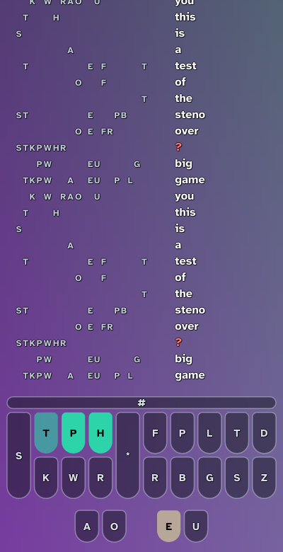

# Steno overlay: plan

An on-screen steno keyboard and tape, drawn on the right edge of the screen while a
steno layer is active. Transparent, never takes clicks or focus, gone when steno is off.

Status: built on the `steno-overlay` branch. The tests pass and `keymux overlay --demo` has
been run on niri (surface accepted, translucent, hot reload works). **Not yet run against the
installed daemon**: that needs `make install` and a daemon restart. See **Steps**.



*Rendered offscreen by `OVERLAY_PREVIEW=/tmp/o.ppm cargo test preview -- --ignored` at 2x:
`T P H E` chord, `P H` still held.*

## Shape

```
 root daemon (evdev, no Wayland access)          user session
 ┌───────────────────────────────┐               ┌──────────────────────────────┐
 │ KeymapProcessor (per keyboard)│               │ keymux overlay               │
 │   steno press/release/stroke  │               │  ┌ ipc thread ┐  ┌ wayland ┐ │
 │        │ publish (non-block)  │   /run/       │  │ reads      │→ │ calloop │ │
 │        ▼                      │  keymux.sock  │  │ snapshots  │  │ redraw  │ │
 │   OverlayHub (Mutex+Condvar)  │──────────────▶│  └────────────┘  └─────────┘ │
 │   one streaming thread per    │  length-      │   layer-shell surface,       │
 │   subscriber                  │  prefixed     │   right edge, no input       │
 └───────────────────────────────┘  bincode      └──────────────────────────────┘
```

The daemon runs as root and can't reach the Wayland socket, so drawing happens in a
user process, the same split as the `niri-daemon` focus watcher. It ships as
`keymux overlay` with a `systemd/keymux-steno.service` user unit.

## 1. State in the daemon: `OverlayHub` — `src/steno/overlay.rs` [done, tested]

The overlay wants *the latest state*, not every event. So the hub stores one snapshot
and a generation counter instead of queueing events:

```rust
struct OverlaySnapshot {
    generation: u64,           // bumped on every change
    layer: Option<String>,     // Some(name) while a steno layer is on top → overlay visible
    chord: u32,                // stroke bits pressed so far in the stroke in progress
    held: u32,                 // stroke bits physically down right now (subset of chord)
    tape: VecDeque<TapeEntry>, // bounded ring, newest last, TAPE_CAPACITY entries
}
struct TapeEntry { seq: u64, stroke: u32, text: String, unmatched: bool }
```

- **Writers** (key path): lock, mutate, `generation += 1`, `notify_all`. The lock is
  uncontended (subscriber threads hold it only to clone ~1–2 KB), so a publish costs
  tens of nanoseconds. Never blocks on I/O. Never allocates for `chord`/`held`/`layer`
  changes. A tape push allocates one short `String`.
- **Readers** (one thread per subscriber): wait on the condvar until `generation`
  differs from the last one sent, clone, release the lock, serialize, write. A slow
  overlay just skips intermediate generations. It can never back-pressure typing.
- Coalescing is automatic: ten key events between two wakeups = one frame.
- The hub is a process-global (`OnceLock`), so `KeymapProcessor::new` and the many tests
  that build one don't need a new parameter. With no subscriber it still keeps state,
  so a newly started overlay gets the full current picture on its first frame.

Bits are Plover slot order (`steno::layout::SLOTS`), so the overlay needs no dictionary
or layout knowledge, only the 23-slot geometry.

### Publish points — `steno/engine.rs`, `event_processor/keymap.rs` [done, tested]

| Event                                   | Call                               |
|-----------------------------------------|------------------------------------|
| stroke key down / up                    | `hub.set_keys(chord, held)`        |
| stroke finished, translated             | `hub.push_stroke(stroke, text, unmatched)` |
| top layer changes (checked after every `process_key`) | `hub.set_layer(Some/None)` |
| `*` undo / Space retype                 | `push_stroke` with the retyped text |

`StenoEngine` needs two small getters: `chord_bits()` / `held_bits()` (from
`ChordState`), and `translate()` hands back `(stroke, description, unmatched)`, the same
values it already writes to the tape file, so the on-screen tape and
`keymux steno tape` always agree.

Layer detection today only happens on the next key press (`steno_active`). For the
overlay, compare `layer_stack.current_layer()` before/after each `process_key` and
publish on change. This makes `TO("steno")` show the overlay on the press itself.

Multiple keyboards: one hub shared by every keyboard, and every key event (press or
release) publishes *that keyboard's* steno layer, which the hub ignores when it is
unchanged. So the overlay follows whichever keyboard you touched last, re-evaluated on every
key: a key on a steno keyboard shows it, a key on one that is on base hides it. With a
steno-only Glove80 and a laptop keyboard, typing on the laptop hides the overlay and
touching the Glove80 brings it back. Stroke keys and the tape are shared state, so a stroke
mid-way when you switch keyboards is dropped from the display (the layer change clears it).

At daemon start a keyboard on a steno `default_layer` shows the overlay straight away. One
starting on base publishes nothing, so it can't hide the overlay for a steno keyboard that
started first; it takes over on its first key.

## 2. Wire protocol — `src/ipc.rs` [done, tested over a socket pair]

- New `IpcRequest::SubscribeOverlay`. The IPC accept loop handles it **before** the main
  loop: it hands the `UnixStream` to a new thread and goes back to accepting. The
  daemon's main loop never sees it.
- That thread writes `OverlayFrame` messages: `u32 LE length + bincode`, same framing as
  responses. It exits on the first write error (overlay closed).
- `OverlayFrame = OverlaySnapshot` for now. The tape holds up to 160 lines (enough for a
  tall screen), so a full frame is a few KB: still cheap to serialize on every key event.
  If that ever matters, send only `tape_since(seq)` instead.

## 3. Overlay process — `src/overlay/` [done; checked live on niri with `--demo`]

| File          | Job |
|---------------|-----|
| `mod.rs`      | `run()`: load config, start subscriber, run the Wayland loop |
| `client.rs`   | subscriber thread: connect, read frames, forward to the loop via a `calloop::channel`. Reconnects with backoff when the daemon restarts |
| `wayland.rs`  | sctk: one `LayerSurface` on `Layer::Overlay`, anchored `TOP \| BOTTOM \| RIGHT` with height 0 (the compositor makes it the output's height), `KeyboardInteractivity::None`, `exclusive_zone(-1)` (ignores bars, pushes nothing), empty input region (clicks fall through). Created when a steno layer turns on, destroyed when it turns off. The layout is rebuilt from the height in each configure |
| `render.rs`   | pixels with `tiny-skia`: the tape down the screen and the keyboard at the bottom, no background by default. Pure function of `(snapshot, config, scale, height)`, unit-testable without Wayland |
| `geometry.rs` | Steno key rectangles, computed once per size: 23 slots as tall pads (two rows per hand, `#` bar on top, `A O` / `E U` thumbs) |
| `glyphs.rs`   | `ab_glyph` rasterizer with a coverage cache: `[Option<Glyph>; 128]` for ASCII (array index, no hashing), `FxHashMap<char, Glyph>` for the rest. Each glyph is rasterized once per size |

### Font

Atkinson Hyperlegible, the font the steno-lessons site uses for keys (`--key-font`),
designed by the Braille Institute so that easily confused letters stay distinct.
The Bold face is embedded with `include_bytes!` from `assets/fonts/` (≈55 KB, SIL OFL
1.1, `assets/fonts/OFL.txt` ships beside it). Embedded means no fontconfig lookup and
the same look on every machine. `font: Some(path)` in config overrides it.

It's proportional, so the tape doesn't rely on monospace: every slot has its own column,
sized to its letter, and the letter is centred in it. Steno lines still align.

### Drawing cost

- **No timers.** The loop sleeps in `calloop` until a frame or a Wayland event arrives.
  Zero CPU while idle, zero while steno is off (surface unmapped).
- **Redraw only on a change.** A frame identical on screen (same layer, keys and newest
  tape line) is skipped. Layer changes create or destroy the surface.
- **Whole-surface redraw, no partial damage.** Measured in a release build with the demo
  redrawing several times a second on a full-height (340 × 1080) overlay for 21 s: 100 ms of
  CPU in total (≈0.5% of a core), 10 MB RSS. That includes startup and the soft text shadow, and
  works out to roughly a millisecond per frame, so tracking dirty rectangles would add code
  for nothing measurable. Revisit only if frames get much more expensive (a 4K screen is ~4x
  the pixels).
- **Frame callbacks**: at most one pending frame. A burst of strokes between vblanks is
  drawn once with the latest state.
- **Buffers**: sctk `SlotPool` (shm). It hands back a slot the compositor has released.
- **Pixel format**: `wl_shm::Format::Abgr8888` = tiny-skia's RGBA premultiplied byte order
  on little-endian, so tiny-skia draws straight into the shm buffer. Falls back to
  `Argb8888` with an R/B swap if a compositor doesn't offer it.
- Size: `width` (340) × the output's height, logical px; drawn at the output's integer scale.

### Look (from the mockups)

- No background by default (`background: 0.0`): only the keys and the text are drawn, so
  everything must read over any wallpaper, a white window included, with no backing and no
  theme setting. The look is quiet, like a native HUD, and works without any plate, ring or
  hard outline:
  - Light text sits on a soft shadow, a very dark blue-grey ([4, 8, 20]) at 175/255 of the
    text's own alpha, dropped one pixel: each glyph's mask blurred twice with a Gaussian (sigma
    0.9 and sigma 2.4, weights 0.9 each, clamped), so a dense core hugs the stem and a gentle haze
    reaches about seven pixels. Computed once per glyph and cached with it. A one-pixel solid ring
    (the previous design) made the text look like cut-out letters, "ransom note"; a dark plate
    (rejected before that) is a background. Dark text on a lit key gets no shadow.
  - The text is slightly transparent: `text_opacity` (default 0.65; 0.85 read as too opaque, 0.5 is too faint over white and over a code window; 0.65 is the lowest that stays legible over white, grey, black, a busy photo and a mock code window, the shadow carrying legibility) scales the strokes, the words
    and the unmatched colour, so the window behind shows through a little. Over a white window the
    light text is soft; that is accepted, there is no light mode.
  - Lines are compact: the line pitch is 0.86 of the words' text size (28 px before, 24 px now at
    width 340, line gap 0 in effect, only room for the underline), the letters are about 9%
    smaller (`REFERENCE_KEYS` 11.5), and the tape now runs all the way up the screen by default
    (`tape_lines: None` = as many lines as fit; `Some(n)` caps it). The surface was already the
    full output height (anchored top, bottom and right, size height 0, exclusive zone -1, empty
    input region), so no surface change was needed; `TAPE_CAPACITY` went from 160 to 400 entries
    so a tall screen at small text can fill. The overlay is symmetric, measured to the ink: the
    keyboard's lowest edge is `margin_y` (14 logical px by default, never under 6) above the bottom of the surface, and the tape's first
    line puts its topmost ink (capitals and tall letters, not the empty line box above them) the same `margin_y` below the top. `margin_y` is
    the single source for both ends; the surface is the full output height (exclusive zone -1), so it is also the gap to the screen edges. If a
    compositor or bar leaves a bigger gap below the diagram than 14 px, raise `margin_y` to match and the tape stops that far below the top.
    A full-height tape spreads the leftover (under one line) over its lines, a fraction of a
    pixel each, so the ink starts exactly at the margin; a capped tape keeps the natural pitch. Tests render the tape at 1080/1440/2160 px,
    scales 1 and 2 and margins 6 to 60 and check the ink above the tape equals the gap below the keyboard within 2 px. The
    fade is only the end of the tape: every line is full strength except the last
    `tape_fade_lines` (default 5) at the top, which fall in even steps to `tape_fade` (default 0.15)
    at the topmost line (a wrapped entry takes its bottom line's strength). A tape that does not
    fill the area does not fade. At 1080 px high 39 lines fit, at 1440 px 55, at 2160 px 88 (width 340, scale 1, `margin_y` 14; the counts are the same as before the ink-exact margin; with `margin_y` 30 they are 37, 54 and 86).
  - A lit key glows in its own colour: its outline stroked five times, widest and faintest first,
    reaching 6 px past the key (alpha .05 to .24 per layer, half strength for a key in the stroke
    but let go), painted for all lit keys before any key so a glow never covers a neighbour.
  - Unlit keys' outline is 1.5 px and a dimmer blue-grey ([140, 154, 190, 105]), which does not
    glare over mid-grey. The two keys of a column that go together are at least 2 px apart
    (0.7 of the ordinary gap, never under 2 px).
  Tried and rejected: the hard 1 px ring; a barely-there per-line gradient scrim (it greys a
  white window into a smudge without helping the light text enough); reading the pixels behind
  the overlay to adapt is not possible from a layer-shell client without a screen-capture
  protocol, so it is not done. `preview_backdrops` writes the tape and the lookup over white,
  black, grey, a noisy photo-like gradient and a mock code window for eyeballing.
- Keys are steno pads, 1.75× as tall as wide: a squarish top with slightly softened corners
  (radius 0.2× the width) and a fully round bottom. `S-` and `*` are double height, `#` is a
  thin pill across the top, thumbs sit below. Unlit keys are a faint glass fill with a thin
  light outline. Keys in `chord` but no longer in `held` are dimmer, so you see the stroke
  building.
- Lit keys are coloured by part of the keyboard (`KeyGroup` in `geometry.rs`): left hand
  green, thumb vowels yellow, right hand a soft red, and `*` and `#` light blue.
- The overlay is as tall as the screen, pinned to the right edge. The keyboard sits at the
  bottom; the tape fills everything above it, newest line at the bottom. How many lines fit
  is worked out from the height the compositor configures.
- Tape lines are Atkinson Hyperlegible Bold throughout. The strokes are the steno letters in
  soft light grey (not green: it fought the wallpaper), each slot in its own column, so
  strokes line up from line to line, as on a paper tape. The column widths are not a uniform
  grid: each is as wide as its own letter plus a 4% gap (`SLOT_GAP`), so `W` gets more room
  than `T`, nothing overlaps, and neighbouring letters sit as tight as ordinary text. That
  spacing applies to the steno letters only; the words are set with normal spacing. The words
  (what the stroke typed) are near-white and at least as big as the strokes (1.04×), since
  that is what you read. Unmatched strokes show a red `?`. Lines are set close (0.86× the
  text size), so entries read as a list, not as separate blocks.
- Every tape line is full strength. Only the top four lines fade (20%, 40%, 60%, 80%), so the tape
  stays easy to read all the way up.
- All sizes come from `width`: the steno letters are sized so about eleven and a half keys (each
  its letter plus the 4% gap) fill 46% of the width inside the padding, which at the default
  width of 340 makes them about 25 px tall (a grid sized for all 23 keys made them too small;
  sized for eight they were too big); key labels are 72% of a key's width. `text_scale`
  multiplies the text on top. A stroke with more keys than that is set in the next smaller of
  four sizes (`STROKE_TIERS`: full, 0.8, 0.62, 0.42), the largest it fits the paper in, so
  every key fits however many sounds you type in one stroke and letters are never drawn on
  top of each other; the smallest size fits all 23 keys plus an extra key.
- **Sharpness.** The text is not hinted, so it is made sharp by construction:
  - Every size is snapped (`glyphs::crisp_size`) so the height of `H` (capitals) or `x`
    (lowercase words) is a whole number of pixels. Otherwise flat tops and bottoms (`E`, `T`,
    `H`) straddle two pixel rows and smear into soft grey lines. A test checks the edges are
    solid rows at the snapped size and smeared at an arbitrary one (12.6 px).
  - Every letter is placed on a whole pixel, and words advance by whole pixels, so vertical
    stems sit on one pixel column. The cost is letter gaps that are off by up to half a
    pixel. (Quarter-pixel placement was tried first, for even spacing, and looked soft.)

## 4. Config — `src/config/config.rs` [done, hot reload checked live]

```ron
overlay: (
    enabled: true,
    output: None,          // Some("DP-1") to pin a monitor; None = compositor's choice
    margin: 0,             // gap from the right screen edge, logical px
    margin_y: 14,          // gap below the keyboard diagram and above the tape's first line of ink (the same at both ends), logical px; at least 6
    width: 340,            // as tall as the screen; text and keys are sized from this
    text_scale: 1.0,       // multiplies the text size on top of what width gives
    background: 0.0,       // dark panel behind it all; 0.0 is fully transparent
    text_opacity: 0.65,    // how opaque the tape's text is; lower lets the window show through
    keyboard: true,
    tape: true,
    tape_lines: None,      // Some(20) caps it; None fills the screen height
    tape_fade: 0.15,       // the oldest line's strength
    tape_fade_lines: 5,    // how many lines at the top fade; every other line is full strength
    tape_transparent: true, // transparent strokes (a lookup, ...) show dimmed on the tape; false leaves them out
    font: None,            // path to a .ttf/.otf; None = embedded Atkinson Hyperlegible
    layers: [],            // steno layers that show it; empty = every steno layer
),
```

The overlay process reads this itself (the user can read their own config). The daemon
doesn't need it. Visibility rules stay in the overlay, so changing look/size never
touches the daemon. Hot reload: a thread watches the config directory with `notify`,
reparses on a save, and the overlay rebuilds its layout and recreates the surface.

## 5. Steps

Done and tested: hub, publish points (`steno_tests.rs` drives a real `KeymapProcessor` into a
private hub), IPC stream (socket-pair test), drawing, config and hot reload, systemd unit,
README, example config.

Done by hand on niri with `keymux overlay --demo`: surface accepted on the Overlay layer with
keyboard interactivity none; panel translucent over windows; config edits applied live;
surface gone when the process stops.

**Still to do, needs your machine:**
1. `make install`, restart the daemon, run `keymux overlay --dump`, write some strokes.
   Proves the daemon-to-overlay path with real keyboard input.
2. `keymux overlay`, then switch into steno: the panel should appear on that key press.
3. Click on the panel's area: the click should reach the window underneath. Not tested yet.
4. `systemctl --user enable --now keymux-steno.service`.

## 6. Live lookup — `src/steno/lookup.rs` [done, tested; not yet tried on real hardware]

"Midway through typing, forgot the stroke for a word." A `{PLOVER:LOOKUP}` dictionary entry opens a
submode **inside the steno engine**: the layer doesn't change, but while it is open the layer's
keys are plain QWERTY input to a query buffer, all swallowed so nothing reaches the app.

- **Trigger.** An ordinary dictionary entry, as in Plover (`run_command` handles `lookup`).
  There is no config setting for it any more. The stroke is *transparent* (see the README's
  "Stroke classes"): it runs the command but never enters the translation history, so a join
  such as `THAS` / lookup / `+EUFG` still joins, and `*` skips it. It is a dimmed line on the
  tape (`TapeEntry::transparent`; `tape_transparent: false` leaves it out, in `render.rs`). The
  keys typed into the lookup go through `lookup_capture`, which calls `process_key_press`
  directly and never reaches `steno_capture`, so they are not strokes and not on the tape.
- **Keys.** `keymap.rs` routes every key to the open lookup (`lookup_key`), US QWERTY by
  keycap, Shift capitalizes (the dictionary is case-sensitive), Backspace edits, Esc/Enter
  close. Esc and Enter win over the layer's own remaps (a steno layer usually remaps Esc);
  other remapped keys, such as one that leaves steno, still work and leave the lookup behind.
  Shift is tracked in `process_key` itself, because its release is swallowed.
- **Results.** Exact outlines for the word first (fewest strokes first, all of them, only ones that
  type it "properly" in a sentence), then words that start with the query, shortest first, each
  with its best outline (no cap but the tape area: up to `TAPE_CAPACITY`, 400 rows, collected best first, and the overlay draws as many as fit, filling the whole tape area down from the top margin, so nothing it could show is dropped; completions only from 2 characters; the next key press cancels a search between rows). This replaced a cap of 12 rows and 4 outlines for the exact word. Built in the daemon
  and sent in the snapshot as `LookupView { query, rows, hint, strokes }`, so the overlay needs no
  dictionary. `strokes` is every stroke of the best outline (empty for a phrase, whose outline is
  a group per word); `hint` is its first.
- **Cost.** Per key press: one hash lookup plus a scan of the distinct translations for the
  completions. `proper_outlines_in` works from the engine's translator, whose dictionary is
  shared through an `Arc`; the existing `proper_outlines` copied the whole dictionary per call,
  which is fine for a CLI command and not for every key press.
- **Overlay.** The lookup replaces the tape, bottom-up like it: a `LOOKUP` label and the query
  with a caret sit just above the keyboard, the results above them with the best nearest, and
  the best result's outline is played on the keyboard, dimly lit like a stroke in progress. One
  stroke stays lit. Several take turns (`anim.rs`: 900 ms each, looping, from when that outline
  appeared; a new best outline starts over, typing more of the same one carries on), and the
  outline's text keeps the stroke being shown at full strength and dims the rest to half instead of
  bracketing it. The event loop sleeps until an event as before; only while a several-stroke
  outline is on a showing panel does it also wake when the next stroke is due (`until_next_step`
  is `None` otherwise), redrawing just when the stroke changed. The "has anything changed"
  check in `wayland.rs` includes the lookup, or typing wouldn't redraw.
- **Extra keys (the `+` join key).** A `Lookup` carries the engine's `Layout` (built from the steno
  layer's `extra_keys`) and parses and prints every outline with it: the typed query
  (`reverse::classify_with`), the rows (`Layout::render_strokes`, so `ED/+-D`, not `ED/-D`), and
  the `hint`/`strokes` bits. The join key is a stroke bit after the number key, so the overlay,
  which has its own copy of the layout, lights it on the stroke that carries it (`+-D`), on the
  top half of `S-` when placed there by `overlay_overrides` (`SplitKey`), or on a tall key of its own in a new column
  (`ColumnBefore("*")` / `ColumnAfter("*")`: `Keyboard::new` inserts the column at that edge, shifts the places
  at or right of it by one and divides the width by one more column; `Keyboard::columns` says which extra keys
  are such keys, so the renderer shapes them like `*`). Merged groups (`merge.rs`) are standard keys only, found
  by neighbours in these rectangles, so a column between two keys makes them non-neighbours. The CLI (`keymux steno lookup`,
  `stroke`, `keys`, `add`) builds the same layout from the config's steno layer
  (`answer::EngineSetup::load`); only with no config or no `extra_keys` is it the plain
  `Layout::plover()` (`reverse::classify`/`display` are that default).
  Which extra key is a join key is the layer's `join_keys` (stored as `Layout::join_mask`, so every
  holder of the layout, `Chain::joins` and `compose::glue_for` included, sees it; a plugin's
  `joins` export is unioned with it). The overlay's own layout copy needs no `join_keys`: it
  only draws.
- **Key groups are data.** Which keys one finger plays together (underlined as one on the tape and
  lookup) is `Layout::key_group(slot)`: an optional group id per key, any number of keys per id.
  `Layout::plover()` declares today's pairs (`T K`, `P W`, `H R`, `A O`, `E U`, `F R`, `P B`,
  `L G`, `T S`, `D Z`, and `S` alone) as that data; the config's `key_groups` (key name to id)
  overrides it per key through `Layout::set_key_group`, applied in `Renderer::with_layout`. An
  extra key sitting on a `SplitKey` slot inherits that slot's group unless `key_groups` names it.
  `extra_colors` (extra key's character to `Left`/`Vowel`/`Right`/`Misc`) sets its colour group,
  `Misc` by default. Nothing in `render.rs` names a particular key or theory. The CLI builds its layout from the
  config too (`answer::EngineSetup::load`, which also applies `key_groups`), so it carries the same group data.
- **Merged keys are overlay-side config.** `src/overlay/merge.rs` holds the pure part: the
  built-in standard groups (`DEFAULTS`, generic steno, no theory's chords; the table is in the
  README), `resolve` (config `merges` over them, validated against the keyboard geometry: connected
  through neighbours within 0.3 key widths, or `bridge: true` and `links`), `links` (the thin
  connectors that join the pieces of a bridged group like `S R`, `K R`: a third of a key thick, at the
  shared height, at most 4 key widths long, nothing of the group in the way; the label goes on the
  biggest key), `select` (a set of groups sharing no key: most lit keys covered, then the biggest
  single group, then fewest groups, then earliest; a capped search over the fully lit groups) and
  `outline`/`path` (union of the member rects, the gaps and the connectors, any hole filled, convex
  corners take the owning member's radius, so two paddles keep an outer quarter circle each and a
  flat bottom). Nothing crosses the wire: the renderer picks groups from `held | chord | hint` each
  frame, so a group fuses and unfuses without flicker. `merge_keys` / `merge_defaults` / `merges`
  (`KeyMerge`: `keys`, `label`, `enabled`, `bridge`) live in `OverlayConfig`.
- **Closing.** Esc/Enter, or leaving the steno layer (the hub clears it on a layer change, and
  the engine on re-entry), so a lookup can never be left eating keys.
- **Needs the overlay.** The query and results are only drawn there, so without
  `keymux overlay` running you'd be typing blind. A terminal fallback is `keymux steno lookup` (or `keys`) with no query: the interactive lookup.

## 7. Runtime controls from the dictionary [done, tested]

`{:overlay:show|hide|toggle}`, `{:tape:show|hide|toggle|clear}`, `{:keyboard:show|hide|toggle}`,
`{:lookup:open|close|toggle}`. User-facing table and compatibility note: README, steno layers.

- **Parse and dispatch.** `steno/overlay_control.rs` parses them. `meta.rs` turns each into an
  action with no text and the engine command `overlay_control:<name>:<param>` (a name of its own,
  because `lookup` is also Plover's command), so they run once, never repeat when held
  (`Translator::is_command` knows them), stay off the tape and keep the formatting state around
  them. They are *transparent* strokes (`is_transparent_mapping` recognises them, so no history
  entry and a join passes over them); only the engine keeps them off the tape, where other
  transparent strokes are dimmed lines. `Engine::run_overlay_control` runs them.
- **State is the overlay's, not the daemon's.** A show/hide/toggle is an event, not a value: the
  hub puts it in `OverlaySnapshot::controls` as a numbered entry (the newest 8, `control_seq` the
  newest number), and the overlay applies each number once (`take_controls`) to its own
  `ViewState { hidden, tape_hidden, keyboard_hidden }`. A toggle resolves against the state of the
  overlay that applies it. `client.rs` drops the history from the first frame of a connection, so
  an overlay that starts (or restarts) begins as configured whatever was toggled before it.
  Nothing is written to the config or to disk; the config watcher's reload rebuilds the renderer
  but leaves `ViewState` alone, so a hide survives a reload. With no overlay running (or
  `enabled: false`) the entries are queued in the hub and never read.
- **Hidden means released.** `has_content` is false when the panel is hidden whole, or when the
  tape and the keyboard are both hidden (or off in config) with no lookup open; then the layer
  surface is destroyed exactly as when leaving the steno layer, which uses the least memory and
  makes `show` one commit. A part hidden alone is skipped in `Renderer::draw_view`; an open lookup
  draws in the tape's place even with the tape hidden. A show clears the click/window-switch
  suppression.
- **`{:tape:clear}`** empties the hub's tape (`OverlayHub::clear_tape`), not `steno tape`'s file.
- **Shared spots with other work** (for a rebase): `meta.rs` (one match arm), `translate.rs`
  (`is_command`, one `||`), `engine.rs` (`run_command` arm and `run_overlay_control`),
  `render.rs` (`draw` now calls `draw_view`).

## 8. Undo at a barrier and `{:undo_or:KEYS}` [done, tested]

- `undo_stops_at_barrier` (steno layer setting) now defaults to true: `*` stops at the last barrier
  (`Translator::take_back`). Blocked, it behaves as undo with nothing to take back: the barrier
  is used up, the history before it is forgotten, and the default fallback (Control+BackSpace)
  is sent. `false` is Plover's behaviour; `plover_tests.rs` and the Lapwing chapter 26 test set
  it false (and the stroke classes off) so they keep checking Plover parity.
- `{:undo_or:KEYS}` is a history macro (`HISTORY_MACROS`, `Translator::macro_undo_or`): `take_back`
  and, if nothing was taken back, the key combination `KEYS` through the same path as the word
  delete fallback. `{:undo_or_ctrl+backspace}` and `{:undo_or:ctrl+backspace}` are shorthands
  (`undo_or_combo`). Redo survives an undo, the fallback empties it. Grammar and examples: README,
  steno layers.
- **Shared spots with other work** (for a rebase): `translate.rs` (`HISTORY_MACROS`,
  `mapping_to_macro`, `translate_stroke`'s `keeps_redo`, `translate_macro` arm, new
  `macro_undo_or` and `undo_or_combo`, the default in `with_history`, tests), `engine.rs` (one
  test config literal), `config.rs` (the default).

## 9. Unloading the engine [done, tested]

`{:engine:unload}` (README, steno layers: "Freeing the dictionaries' memory"). No reload command:
any later stroke loads again.

- **Meta.** `steno/engine_control.rs` (like `overlay_control`): action with no text and the engine
  command `engine_control:engine:unload`; transparent via `is_transparent_mapping`, `is_command`
  (never repeats), command-only so off the tape (`is_control_only`).
- **Where the memory is.** `live.rs` hub entries (`latest` chain, per-file `Parts`), every
  engine's `Translator::dict`, and in-flight lookup searches' translator clones. No custom global
  allocator, so glibc: the packed arrays are heap (`Vec<u32>`), the mapped cache pages are file
  memory. The engine drops its own chain, then `live::unload(cache_dir)` has the loader thread
  drop the hub's, `malloc_trim(0)`, and log the MB freed.
- **Scope.** `live::Scope` per cache folder (epoch + unloaded flag). Another layer sharing the
  folder sees the epoch change on its next press/tick and drops its copy. `from_config` on a
  config reload starts unloaded while the flag is set; `live::subscribe` clears it.
- **Lazy reload.** `StenoEngine::press` (first key of a stroke) and `on_stroke` call `wake`, which
  resubscribes (the loader thread loads; the cache makes it a map+merge) and sets `loading`, so
  strokes queue in `backlog` and replay in order in `tick` (`poll_dictionary`). A queued unload
  re-queues the strokes after it. `refresh` ignores an entry marked unloaded, so file edits load
  nothing; an unload racing a resubscribe is skipped by the loader (the flag is checked under the
  hub lock).
- **Kept.** The translation history (it is in `Translator::shared`, never the dictionary).
  **Dropped:** the open lookup (`close_lookup`).
- **Shared spots with other work** (for a rebase): `meta.rs` (one arm), `translate.rs` (two `||`),
  `engine.rs` (fields, `press`, `tick`, `on_stroke`, `poll_dictionary`, `run_command`
  arm, `is_control_only`), `live.rs`, `parts.rs` (`is_empty`, test only).

## Risks / open questions

- Clicks falling through the overlay: the empty input region is set, and niri reports
  keyboard interactivity none, but a real click hasn't been tried.
- It covers the whole right edge, including the top-right corner of a bar (DMS's bar items
  there, such as a power button). With no background only the faint top tape lines overlap
  it, and clicks pass through, but they are drawn over it. `margin` or `tape_lines` moves it.
- Fullscreen windows: `Layer::Overlay` sits above them. Maybe hide in game mode
  (the hub already knows `disabled_in_game_mode` layers aren't capturing).
- Fractional scale: integer scales are handled (the panel redraws at the output's scale).
  A fractional scale gets the next integer up, which the compositor shrinks. Add
  `wp_fractional_scale` + viewporter only if it looks soft. All three of your monitors are
  at scale 1, so this is untested on a scaled output.
- GNOME has no layer-shell: the overlay logs and exits there. Not a target.
